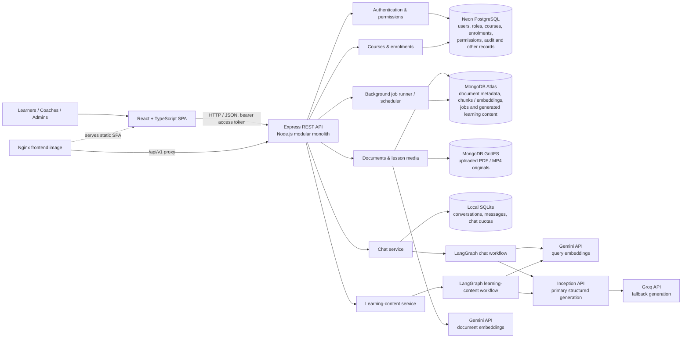

# AI Learning Assistant — High-Level Architecture

This document describes the implementation currently wired by the backend entry point, rather than an intended future design. The platform is a TypeScript modular monolith: one Express API process hosts the application services, AI workflows, and background job runner.

## 1. System overview

The platform helps learners study instructor-created courses using lesson material and an AI assistant. Its application roles are **learner**, **coach** (instructor), and **admin**.

Key implemented features include:

- Account registration, login, password changes, roles, and permissions.
- Course authoring, administrator approval, learner enrolment, and lesson editing.
- Course PDF and MP4 uploads, document processing, and access-controlled downloads.
- AI chat grounded in course documents, with source citations and saved conversations.
- Generated summaries, flashcards, and quizzes, plus quiz attempts.
- Administrative user, course, privacy-erasure, and operational workflows.

The React frontend calls the backend REST API; AI provider credentials and data stores remain server-side.

## 2. Architecture diagram

The frontend Nginx image is a separate build artifact; the checked-in Compose file starts only the backend.

## 3. Main components

| Component | Responsibility | Technology in the repository |
|---|---|---|
| Frontend | Course discovery and authoring, lesson viewing, chat, learning activities, and admin screens. | React 19, TypeScript, Vite, React Router, Material UI. |
| Backend/API | REST endpoints, validation, authorization, business rules, and storage/provider composition. | Node.js 22.13+, TypeScript, Express 5, Zod. Routes are under `/api/v1`; OpenAPI is served by the API. |
| AI/LLM layer | Document/query embeddings, retrieval, grounded chat, and generation of learning content. | LangGraph.js, Gemini embedding API, Inception and Groq OpenAI-compatible chat-completion APIs. |
| Relational database | Core application records, including users, permissions, courses, lessons, enrolments, refresh tokens, audit records, quiz attempts, and other system collections. | PostgreSQL, configured for Neon. Course records use a JSONB `lessons` array. |
| Document and job metadata | Uploaded-document metadata, extracted chunks and vectors, background jobs, and some generated learning records. | MongoDB/MongoDB Atlas. Atlas Vector Search is required for chunks. |
| Original file storage | Uploaded file bytes, including lesson PDFs and videos. | MongoDB GridFS bucket `document_uploads`. |
| Conversation storage | Chat conversations, messages, and daily chat usage in the current server wiring. | Local SQLite database under `DATA_DIR/sqlite`. |
| Authentication | Password verification, access tokens, rotating refresh tokens, and permission enforcement. | Argon2id password hashes, JWT access tokens, opaque hashed refresh tokens in PostgreSQL, and an HTTP-only refresh cookie. |
| Background processing | Document ingestion/cleanup and other queued maintenance work. | In-process job runner and scheduler; job records are stored in MongoDB. |

The backend's system collections are registered over PostgreSQL and MongoDB at startup. Some class and folder names retain `jsonstore` terminology, but the live server constructs PostgreSQL/Mongo-backed collections; the JSON files are not the runtime course source.

## 4. Data model

| Entity | Representation and relationships |
|---|---|
| User | PostgreSQL record with a role, status, password hash, and account-security fields. A user can own courses, enrol in courses, upload personal notes, and own conversations. |
| Course | PostgreSQL row owned by a coach. It has approval/status and version fields, and relates to learners through enrolments. |
| Lesson | Not a separate database table: an ordered item embedded in the course's JSONB `lessons` array. It has an ID, title, introduction, optional PDF document ID, and optional video document ID or video URL. Application validation allows up to 100 lesson items. |
| Enrolment | PostgreSQL record connecting a user and course, with pending/approved/rejected/removed states. Approved enrolment grants learner access to course lessons and files. |
| Document | Metadata is managed by the MongoDB document repository and associated with a course, owner, and course/personal scope. A lesson references its attached course PDF or video by document ID. |
| File | Original PDF/MP4 bytes are stored in GridFS and referenced by a storage key in document metadata. |
| Chunk | Extracted text, page/section metadata, and a Gemini embedding are stored in MongoDB. Each chunk belongs to a document and course. |
| Conversation / message | In the current server wiring, these are SQLite records owned by a user and associated with a course. Assistant messages retain grounding status and validated citations. |
| Learning content / quiz attempt | Summaries, flashcards, and quizzes are persisted through the learning repositories; quiz attempts record a learner's submission and score. |
| Lesson progress | No per-lesson completion/progress entity or progress endpoint was found. Quiz attempts and activity events exist, but they are not lesson-completion records. |

The database schema and application schemas are in [backend/migrations/004_courses.sql](backend/migrations/004_courses.sql) and [backend/src/infra/jsonstore/system-collections.ts](backend/src/infra/jsonstore/system-collections.ts). The latter is also used to validate records persisted by the active stores.

## 5. Key data flows

### A. Learner opens a lesson

1. The frontend requests the course's lessons from `GET /api/v1/courses/:courseId/lessons`.
2. The API authenticates the learner and checks course ownership or approved enrolment.
3. The response includes lesson text and safe metadata for linked, available documents.
4. For a PDF or MP4, the frontend requests the document file endpoint. The API repeats the access/status checks, reads the original from GridFS, and returns it to the browser.

### B. Learner asks the AI assistant a question

1. The frontend sends the course ID, question, and optional conversation ID to `POST /api/v1/chat/ask`.
2. The chat service verifies course and conversation access and checks chat request/token quotas.
3. The workflow embeds the question with Gemini, searches ready course documents and the learner's own personal notes, and prepares bounded context.
4. The configured LLM generates a structured answer. The API validates citations against retrieved chunks before returning the answer.
5. The question, answer, and validated citation metadata are saved to the active conversation store (SQLite in current server wiring).

### C. Instructor adds a course or lesson

1. An authenticated coach with the relevant permission creates a course through `POST /api/v1/courses`. New courses enter the approval workflow before learner discovery.
2. Course PDFs are uploaded as course documents and processed asynchronously. MP4 lesson videos are uploaded separately and stored as ready media.
3. The coach submits the ordered lesson list with `PUT /api/v1/courses/:courseId/lessons`, referencing ready course PDF/video documents. The update checks the course version and records an audit event.
4. An administrator reviews the course. Approved courses can be discovered and joined by learners; coaches manage enrolment requests.

## 6. AI assistant design

**Document ingestion.** Uploaded PDFs, DOCX files, and UTF-8 text files are extracted, split into chunks (configured defaults: 512 tokens with 100-token overlap), embedded using Gemini `gemini-embedding-001`, and written to MongoDB. PDF page metadata is retained. The API requires a queryable Atlas Vector Search index named `document_chunks_vector`.

**Retrieval and answer generation.** The chat graph processes the question, rewrites it, embeds it for retrieval, searches authorized ready documents, builds a context window, gates insufficient evidence, generates an answer, and validates citations. Retrieval combines semantic vector scores with BM25 keyword scores using weighted reciprocal-rank fusion. The graph contains a `rerank` stage, but its current implementation passes results through unchanged.

The graph sends the question, bounded conversation history, and selected evidence to a structured-output service. The configured primary provider is Inception; Groq is used as a fallback when the primary fails or its output cannot be repaired/validated. Default model names in `backend/config/default.json` are `mercury-3` (Inception) and `openai/gpt-oss-20b` (Groq). Prompts are loaded by configured prompt version, and generated answers must cite validated source chunks.

**Video limitation.** MP4 lesson videos are stored and served as media, but the ingestion service does not extract audio or create transcripts. Retrieval explicitly excludes video files, and no transcription/ASR implementation was found. Therefore, video content is not currently searchable by the assistant unless its text is separately provided as a supported document.

Embeddings and prompts are implementation details in [backend/src/modules/documents/document.ingestion.service.ts](backend/src/modules/documents/document.ingestion.service.ts), [backend/src/modules/retrieval/retrieval.service.ts](backend/src/modules/retrieval/retrieval.service.ts), and [backend/src/ai/graphs/chat.graph.ts](backend/src/ai/graphs/chat.graph.ts).

## 7. External services and integrations

| Service | Use |
|---|---|
| Neon PostgreSQL | Relational application data, including course and enrolment records. |
| MongoDB Atlas | Document metadata, job and learning collections, extracted chunks, and Atlas Vector Search. Uploaded file bytes use GridFS in the configured MongoDB database. |
| Google Gemini API | Document and query embeddings. |
| Inception Labs API | Primary structured LLM generation. |
| Groq API | LLM fallback. |
| Browser video playback | Uploaded MP4 files are served by the API. Lesson schemas also contain a video URL field, but course updates reject newly added external video links; there is no video-hosting or transcript API integration in the runtime path. |

## 8. Deployment and infrastructure

- The backend runs as a Node.js process and starts its job runner and scheduler in that process.
- The root [Dockerfile](Dockerfile) builds the backend image. [docker-compose.yml](docker-compose.yml) defines one backend service and a persistent volume for `DATA_DIR`; PostgreSQL and MongoDB are external services supplied through environment configuration.
- [frontend/Dockerfile](frontend/Dockerfile) builds a static frontend served by Nginx. Its [Nginx configuration](frontend/nginx.conf) proxies API paths to a host named `backend`, but the checked-in Compose file does not define a frontend service.
- The API exposes `/health` for liveness and `/ready` for dependency/configuration readiness. Readiness checks PostgreSQL, MongoDB, SQLite, schema version, and provider configuration.
- Configuration is environment-based, with non-secret defaults in `backend/config/default.json`. Secret values are intentionally not documented here.
- No GitHub Actions workflow or specific cloud application-hosting configuration was found. The repository provides Docker artifacts, but not a complete CI/CD or production-hosting definition.

## 9. Security and scalability notes

**Security controls present in code**

- Argon2id password hashing, failed-login lockout, short-lived JWT access tokens, and rotating refresh tokens stored as hashes.
- Refresh tokens are issued in an HTTP-only, Secure, SameSite=Strict cookie by default; the frontend keeps the access token in memory and sends it as a bearer token.
- Authentication, role/permission checks, course-owner and approved-enrolment checks, and user-owned conversation checks protect operations and content.
- Helmet, configured CORS origins, request IDs, schema validation, rate limits, upload validation, and bounded request/file processing are implemented.
- Chat evidence and citations are validated server-side; model output is not treated as a trusted citation source.

**Scaling and operational constraints**

- The README recommends a single backend instance for now. PostgreSQL-backed collection reads are loaded into process-local maps/indexes at startup; changes made by another process would not automatically invalidate those maps.
- Conversations and daily chat quotas currently use a local SQLite file. This requires persistent storage and is not a shared multi-instance store.
- Chat, embeddings, and document ingestion depend on external providers and Atlas Vector Search readiness; provider latency, quotas, and cost affect throughput.
- Background work runs alongside the API process. Scaling the API horizontally requires deliberate review of process-local collection caches, job scheduling, and conversation storage.
- The system sends extracted document text to Gemini for embeddings and sends questions/history/retrieved evidence to configured LLM providers. Data-retention and disclosure requirements should be confirmed for deployment.

## 10. Assumptions and open questions

1. **Conversation storage documentation mismatch:** `backend/src/server.ts` wires `openConversationDatabase` and the SQLite `ConversationRepository`, while the README describes conversations/messages in MongoDB and daily quotas in Neon. Confirm the intended store and align runtime, operations, backup, and architecture documentation.
2. **Document metadata duplication:** the active document service uses `MongoDocumentRepository`, while PostgreSQL collection registration also includes a `documents` mapping. Confirm whether the PostgreSQL records/table are legacy or still required.
3. **Lesson progress:** no per-lesson progress tracking was found. Is lesson completion/progress intended as a feature?
4. **Video learning:** no video transcription or audio extraction exists. Should videos become searchable, and if so, which transcription provider/workflow is approved?
5. **Lesson-scoped chat:** chat requests identify a course, not a lesson. Retrieval searches authorized course material rather than being limited to the currently open lesson. Confirm whether lesson-specific context is required.
6. **Video links:** the lesson schema has a video URL field, but service validation does not permit adding a new external URL. Confirm whether uploaded MP4 is the intended supported path.
7. **Frontend deployment:** the frontend Docker image expects an API host named `backend`, but the checked-in Compose file only starts the backend. Define how the frontend and backend are meant to be deployed together.
8. **Third-party AI data handling:** confirm provider retention, privacy notices, and any deployment-specific restrictions before sending learner questions or course material to external AI APIs.

## Code references

- Backend composition and runtime wiring: [backend/src/server.ts](backend/src/server.ts), [backend/src/app.ts](backend/src/app.ts).
- Frontend routes and API client: [frontend/src/app/App.tsx](frontend/src/app/App.tsx), [frontend/src/api/client.ts](frontend/src/api/client.ts).
- Course, lesson, and document behavior: [backend/src/modules/courses/course.service.ts](backend/src/modules/courses/course.service.ts), [backend/src/modules/documents/document.service.ts](backend/src/modules/documents/document.service.ts).
- AI graph, providers, and storage adapters: [backend/src/ai/graphs/chat.graph.ts](backend/src/ai/graphs/chat.graph.ts), [backend/src/ai/providers/structured-output.service.ts](backend/src/ai/providers/structured-output.service.ts), [backend/src/infra/storage/gridfs-upload-storage.ts](backend/src/infra/storage/gridfs-upload-storage.ts).
