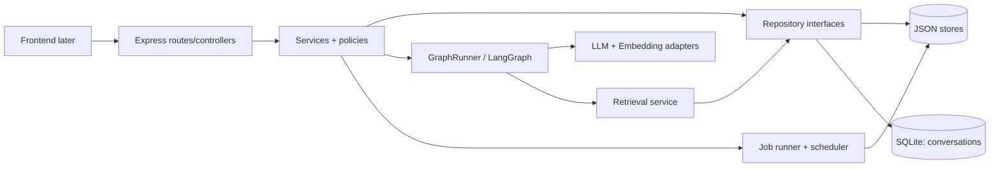
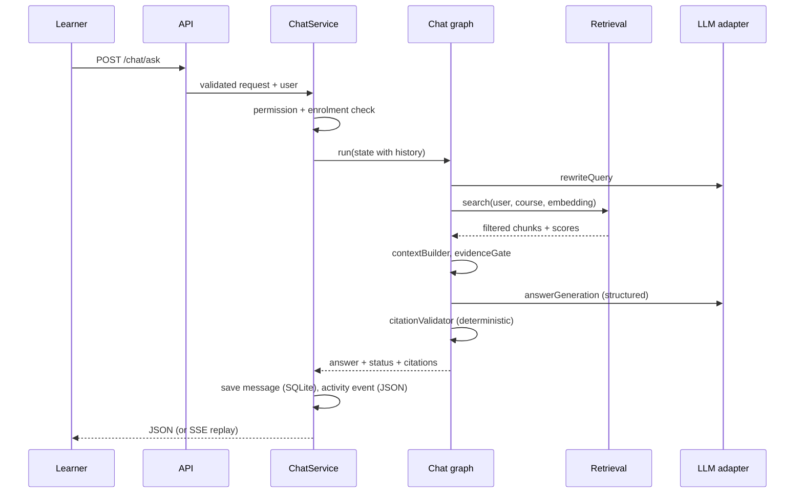

# AI Learning Assistant: Backend Architecture (v2)

**Audience:** the coding LLM that will build the backend. Follow this document. **MUST** means do not deviate. **OPEN** means stop and ask before implementing. **DERIVED** means it follows from a decision but the detail was proposed; implement it and flag it in review.

**Scope:** backend only (Node.js + TypeScript). The frontend comes later and consumes the REST API defined here.

**Companion documents:** `design-decisions.md` (product and access decisions), `Database-Design.md` (field-level data specification; wins over section 5 here on field-level detail), and the original Capstone 01 brief. If this file and `design-decisions.md` disagree, `design-decisions.md` wins and this file must be corrected.

**What changed from v1**
- Real databases are **tabled**. Persistence is **JSON file stores**, except **conversation history, which uses SQLite**. Everything sits behind repository interfaces so MongoDB/PostgreSQL can replace them later.
- Single process (API + in-process job runner and scheduler), because JSON files must have one writer.
- Vector search is in-process cosine similarity (no Atlas).
- Citation validator is **deterministic** (cited IDs must exist in the context set).
- Added: bootstrap/seed script, token lifecycle, query rewriting from conversation history, quiz answer-key protection, concrete contracts, error catalogue, retention and erasure rules, config management, CI and operations, diagrams, and test pass criteria.

---

## 1. Working rules for the coding agent

1. **Build incrementally.** One small piece at a time (one module, one layer, one file). Do not scaffold the whole project in one pass.
2. **Separate files.** Never bundle several modules into one file or one code block.
3. **Comment every function** (purpose, inputs, outputs, errors thrown).
4. **Explain the reasoning before writing code** for each piece, then wait for the owner's go-ahead on anything non-trivial.
5. **No secrets in code or the repo.** All secrets come from environment variables. Provide `.env.example`.
6. **Do not claim tests passed unless they were run.** Record real output.
7. **Do not overwrite existing code without justification.** Inspect first.
8. **Phase gates:** at the end of each step in section 22, summarise the work, list files created/changed, show API examples and test results, disclose known issues, and wait for approval.

---

## 2. Technology stack

| Concern | Choice |
|---|---|
| Runtime / language | Node.js (current LTS) + TypeScript, **strict mode** |
| HTTP framework | Express.js, REST under `/api/v1` |
| Validation | Zod (requests, responses, config, agent I/O) |
| Primary persistence | **JSON file stores** (custom, section 5.2) behind repository interfaces |
| Conversation history | **SQLite** via Node's built-in `node:sqlite` (`DatabaseSync`, Node 22.5+; experimental) |
| Vector search | In-process cosine similarity over stored embeddings (section 10) |
| AI orchestration | **LangGraph.js** (`@langchain/langgraph`) |
| LLM providers | **Inception Labs** (primary; model `mercury-3`, official `inceptionai` SDK, structured output via `response_format: { type: "json_schema", json_schema: { name, strict: true, schema } }`), **Groq** (fallback), behind an adapter |
| Embeddings | **Mistral embeddings only** (DECIDED), behind the `EmbeddingProvider` adapter. Model `mistral-embed` (verify the model name and vector dimension, expected 1024, in Mistral's current docs). Key from `MISTRAL_API_KEY` |
| Jobs / scheduler | In-process runner over a JSON job store (section 13) |
| Auth | JWT access token + rotating refresh token; argon2 password hashing |
| Parsing | `pdfjs-dist` (per-page PDF text), `mammoth` (DOCX), plain read (TXT), `file-type` (content sniffing), `multer` (uploads) |
| Logging | pino, structured JSON with redaction |
| API docs | OpenAPI generated from Zod (`zod-to-openapi`) + Swagger UI at `/api/docs` |
| Testing | Jest + Supertest; separate AI evaluation suite |
| Packaging | Docker (single container + persistent volume), docker-compose |

Pin exact dependency versions (lockfile committed). LangGraph.js in particular changes quickly.

---

## 3. Architectural style

**Modular monolith, single process.** Domain modules are isolated. No microservices. One Node process serves the API **and** runs the job runner and scheduler. This is a hard requirement of the JSON stores (one writer). **Do not run more than one instance** against the same data directory.

### 3.1 Layers (strict, top-down dependencies only)

```
HTTP layer        routes -> controllers          (parse, validate, call service, shape response)
Application layer services                       (use cases, orchestration, authorization policies)
Domain layer      entities, rules, value objects (pure TypeScript, no I/O)
Infrastructure    repositories, adapters         (JSON stores, SQLite, LLM, embeddings, file storage)
AI layer          LangGraph graphs, nodes, prompts (called by services, never by controllers)
```

**Dependency rules (MUST):**
- Controllers call services only. Never repositories, adapters or graphs.
- Services depend on **repository interfaces** (ports), not on JSON or SQLite directly.
- Domain code imports nothing from infrastructure.
- Modules talk to each other only through exported service interfaces (`index.ts` public surface).
- Repositories are the only code that touches storage. Swapping JSON for MongoDB/PostgreSQL later must require changing only repository implementations and wiring, nothing above them.
- The AI layer reaches data only through injected retrieval and repository interfaces.

---

## 4. Project structure

```
backend/
  src/
    server.ts                  # bootstrap: config, stores, job runner, scheduler, HTTP
    app.ts                     # Express assembly (middleware, routes)
    config/                    # env schema (Zod), config loader, config versioning
    common/
      errors/                  # AppError hierarchy, error codes
      middleware/              # requestId, auth, permissions, validate, rateLimit, errorHandler
      logging/                 # logger, redaction
      http/                    # envelope, pagination, SSE helper
    modules/
      auth/  users/  roles/  courses/  enrolments/
      documents/  ingestion/  retrieval/
      chat/  conversations/  learning/  quizzes/
      feedback/  insights/  admin/  audit/  jobs/
    ai/
      graphs/  nodes/  schemas/  prompts/
      providers/               # LlmProvider, EmbeddingProvider + fakes for tests
      validation/              # deterministic citation validator
      evaluation/              # eval runner, datasets, fixtures
    infra/
      jsonstore/               # JSON store engine (section 5.2)
      sqlite/                  # SQLite connection + schema for conversations/messages
      storage/                 # uploaded-file storage adapter (local disk)
  scripts/
    bootstrap.ts               # section 6
    backup.ts  restore.ts
  data/                        # runtime data (gitignored): json/, sqlite/, uploads/, backups/
  config/                      # default.json, ai.json (non-secret config)
  tests/  unit/ integration/ contract/ ai-eval/ fixtures/
  docs/                        # architecture, api, data, security docs
  Dockerfile  docker-compose.yml  .env.example  README.md
```

Each module folder: `<name>.routes.ts`, `.controller.ts`, `.service.ts`, `.repository.ts` (port + implementation in `infra`), `.schemas.ts` (Zod), `.policy.ts` (ownership/permission rules), `.types.ts`, `index.ts`.

---

## 5. Persistence

### 5.1 Stores

| Store | Technology | Contents |
|---|---|---|
| Main data | JSON files (`data/json/`) | users, roles, permissions, role_permissions, user_permission_overrides, refresh_tokens, coach_requests, courses, enrolments, documents, document_chunks, learning_summaries, quizzes, quiz_attempts, flashcards, feedback, audit_logs, activity_events, jobs, agent_executions, gap_reports, config_versions, scheduler_state |
| Conversation history | SQLite (`data/sqlite/conversations.db`) | conversations, messages |
| Uploaded files | Local disk (`data/uploads/`), outside any web root | original files |

### 5.2 JSON store engine (MUST implement as a shared component)

- **Layout:** one file per collection (`users.json`, `courses.json`, ...) containing an array of records. **Exception:** `document_chunks` is stored **one file per document** (`chunks/<documentId>.json`) because chunks carry embeddings and would otherwise make one giant file.
- **Single writer:** all writes go through one in-process store. Each collection has a **write queue (mutex)**; read-modify-write happens inside it.
- **Atomic writes:** write to `<file>.tmp`, flush (`fsync`), then **rename** over the real file. A crash never leaves a half-written file.
- **In-memory cache + indexes:** load collections into memory at startup and keep `Map` indexes for lookups (by `id`, and by declared secondary keys). Reads are served from memory. Chunk files are loaded lazily per document, with an LRU cap (config).
- **Uniqueness and constraints:** enforced in the repository inside the write queue (e.g. `users.email` unique, `enrolments(courseId,userId)` unique). A violation throws `ConflictError`.
- **IDs:** UUIDv4 (or ULID) strings, generated by the store. Timestamps are ISO-8601 UTC strings.
- **Soft delete helper:** records that are stashed carry `status`; default repository queries exclude non-active records through one shared helper (do not re-implement the filter per module).
- **Optimistic versioning:** records that can be edited concurrently (`quizzes`, `courses`) carry an integer `version`; an update with a stale version throws `ConflictError`.
- **Schema versioning:** `data/json/_meta.json` holds `schemaVersion`. Migrations are ordered scripts in `scripts/migrations/`, run at startup (and by bootstrap), each idempotent. Every record shape is validated with Zod on load; invalid records fail startup with a clear message (never silently dropped).
- **Backups:** the store takes a snapshot (copy of `data/json` and the SQLite file) at startup, and a nightly scheduled backup job keeps the last N (config). `scripts/restore.ts` restores a chosen snapshot. Document in the README.
- **Limits:** designed for classroom scale (thousands of records, roughly 20,000 chunks at 1024 dimensions). If a collection file exceeds a configured size, log a warning recommending migration to a real database.

### 5.3 Collections (JSON)

| Collection | Key fields | Notes |
|---|---|---|
| `users` | id, email (unique), passwordHash, displayName, roleId, status (`active`/`suspended`/`archived`), mustChangePassword, failedLoginCount, lockedUntil, createdAt, updatedAt | Stash via `status` |
| `roles` | id, name (`learner`/`coach`/`admin`) | seeded |
| `permissions` | id, key | seeded |
| `role_permissions` | roleId, permissionId | baseline sets, seeded |
| `user_permission_overrides` | userId, permissionId, effect (`grant`/`revoke`) | fine-grained per user |
| `refresh_tokens` | id, userId, tokenHash, familyId, expiresAt, revokedAt, replacedBy | rotation + reuse detection |
| `coach_requests` | id, userId, status (`pending`/`approved`/`rejected`), requestedAt, decidedBy, decidedAt, note | |
| `courses` | id, ownerId, name, description, status (`active`/`archived`), version, createdAt, updatedAt | |
| `enrolments` | id, courseId, userId, status (`pending`/`approved`/`rejected`/`removed`), requestedAt, decidedBy, decidedAt | UNIQUE(courseId,userId) |
| `documents` | id, courseId, ownerId, scope (`course`/`personal`), filename, mimeType, sizeBytes, contentHash, storageKey, status (`uploaded`/`processing`/`ready`/`failed`/`deleting`), errorCode, errorDetail, extractionDiagnostics, pageCount, embeddingModel, createdAt | |
| `document_chunks` (per-document file) | id, documentId, courseId, ownerId, scope, chunkIndex, text, pageStart, pageEnd, section, embedding (base64-encoded Float32Array; ~4 KB per 1024-dim vector versus ~10 KB as a JSON number array), embeddingModel, createdAt | |
| `learning_summaries` | id, courseId, ownerId, visibility, scope (`document`/`section`), sourceDocumentIds, sourceChunkIds, sourceHash, content, version, createdAt | |
| `flashcards` | one record per generated set: id, courseId, ownerId, visibility, status, title, cards[{id, front, back, sourceChunkIds}], sourceHash, version, createdAt | see `Database-Design.md` 6.5 |
| `quizzes` | id, courseId, createdBy, origin (`coach`/`learner_generated`), visibility (`course`/`private`), ownerId, status (`draft`/`published`/`superseded`), lineageId, version (each version is its own record), title, questions[], sourceDocumentIds, sourceChunkIds, generationParams, createdAt, updatedAt | see section 11 and `Database-Design.md` 6.2 |
| `quiz_attempts` | id, quizId, quizVersion, userId, answers[], score, maxScore, startedAt, submittedAt | |
| `feedback` | id, messageId, courseId, userId, rating (`helpful`/`not_helpful`), comment, createdAt | |
| `audit_logs` | id, actorId, action, targetType, targetId, before, after, requestId, createdAt | **No content, no secrets** |
| `activity_events` | id, dedupeKey (messageId or attemptId), courseId, userId, type, groundingStatus, createdAt | **No text.** Aggregated in code |
| `jobs` | id, type, status (`queued`/`running`/`done`/`failed`/`dead`), attempts, maxAttempts, lockedUntil, runAfter, payload, result, error, createdAt, updatedAt | |
| `agent_executions` | id, executionId, requestId, graph, node, status, durationMs, tokenUsage, provider, model, promptVersion, errorCode, createdAt | **No prompts, outputs or document text** |
| `gap_reports` | id, courseId, periodStart, periodEnd, topics[] (theme, questionCount, distinctLearnerCount, suggestedAction, trend), createdAt | **No question text** |
| `config_versions` | id, version, changedBy, before, after, createdAt | |
| `scheduler_state` | taskName, lastRunAt, nextRunAt | prevents duplicate runs after restart |

### 5.4 SQLite (conversation history only)

```
conversations(id TEXT PK, user_id TEXT NOT NULL, course_id TEXT NOT NULL, title TEXT,
              created_at TEXT, updated_at TEXT)   -- hard delete; messages cascade
messages(id TEXT PK, conversation_id TEXT NOT NULL REFERENCES conversations(id) ON DELETE CASCADE,
         role TEXT CHECK(role IN ('user','assistant')), content TEXT, created_at TEXT,
         execution_id TEXT, intent TEXT, grounding_status TEXT,
         cited_chunk_ids TEXT /* JSON array */, cited_document_ids TEXT /* JSON array */,
         retrieval_score_top REAL, question_embedding_ref TEXT)
INDEX conversations(user_id, course_id, updated_at DESC)
INDEX messages(conversation_id, created_at)
INDEX messages(grounding_status)
```
- Use parameterised queries only. WAL mode on. One connection, synchronous driver, wrapped by a repository so it can be swapped for another SQL/Mongo implementation.
- A user may only read their own conversations (policy check in the service, not only in the query).
- Admin endpoints never read this database.

### 5.5 Cross-store consistency rules (MUST)

- **Access check first.** Enrolment, ownership and permission checks run against the JSON stores **before** any chunk, message or quiz query.
- **No transactions across stores.** Multi-step operations (document delete, user/course stash, erasure) run as **idempotent jobs** so a failure midway can retry.
- **Chat turn writes** (SQLite message, then JSON `activity_events`): write the message first, then the event with `dedupeKey = messageId`. Event writes are **at-least-once and deduplicated**. On startup and in the nightly job, a **reconciliation task** finds assistant messages with no matching event (and events whose message was deleted) and repairs them.
- Reconciliation also finds chunks/documents whose course or owner is missing or stashed.

### 5.6 Migration path to real databases (design constraint)
Because services use repository interfaces, moving to MongoDB (documents, chunks, jobs, executions) and PostgreSQL later means writing new repository implementations and a one-off migration script that reads the JSON files. Vector search would move to Atlas Vector Search behind the same `ChunkSearch` interface. **Do not leak JSON-specific assumptions above the repository layer.**

---

## 6. Bootstrap and seed (`scripts/bootstrap.ts`, `npm run bootstrap`)

Purpose: create a usable, secure initial state from an empty checkout. It MUST be **idempotent** (safe to run repeatedly).

**Steps**
1. Create `data/` subdirectories and `_meta.json` (`schemaVersion`); run pending migrations.
2. Initialise the SQLite schema (section 5.4).
3. Seed `roles` (`learner`, `coach`, `admin`), `permissions` (all keys in section 7.4) and `role_permissions` baseline sets. Existing rows are left unchanged; missing ones are added.
4. Create the **first admin** from environment variables `BOOTSTRAP_ADMIN_EMAIL` and `BOOTSTRAP_ADMIN_PASSWORD`:
   - Fail with a clear message if either is missing, or if the password is shorter than the configured minimum / on a deny-list of weak values.
   - If any admin already exists, skip (log "admin already exists"). Never overwrite an existing user.
   - Set `mustChangePassword = true`. **Never log the password.**
5. Write an `audit_logs` entry (`bootstrap.admin_created`, no secrets).
6. Optional flag `--demo`: seed a clearly fake demo dataset (one demo coach, two demo learners, one course, sample documents already ingested through the normal pipeline using the fake embedding provider). Demo accounts use obviously fake emails and are refused when `NODE_ENV=production`.
7. Optional flag `--reset --yes`: wipe `data/` and re-bootstrap. **Refuse in production** and require the explicit `--yes`.

**Output:** a short summary of what was created or skipped. **Acceptance:** after `npm run bootstrap` and `npm start`, the admin can log in, change the password, and approve a coach request without manual file edits.

---

## 7. Authentication, authorization and roles

### 7.1 Token lifecycle (MUST)
- **Access token:** JWT, short-lived (config, e.g. 15 min), sent as `Authorization: Bearer`. Claims: `userId`, `role`, `permsVersion`. Effective permissions are resolved server-side (brief cache), so admin changes apply quickly.
- **Refresh token:** opaque random value, stored **hashed** in `refresh_tokens`, delivered as an `httpOnly`, `Secure`, `SameSite=Strict` cookie (and accepted in the body for non-browser clients if configured). **Rotation on every use** with `familyId`; presenting a revoked/used token **revokes the whole family** (reuse detection).
- **Logout** revokes the token (family). Suspended/archived users cannot log in or refresh.
- **Password reset:** email delivery is out of scope. Admin-initiated reset sets a one-time reset token shown to the admin once, and `mustChangePassword = true`. (DERIVED)
- **Lockout:** after N consecutive failed logins (config), lock for a cool-down (`lockedUntil`). Rate-limit login and registration by IP and by email.
- **CORS:** explicit origin allowlist from config. Cookies require it. No wildcard with credentials.

### 7.2 Registration and coach approval (DECIDED)
1. `POST /auth/register` with optional `requestCoach: true`.
2. The account is created with role **learner**. If `requestCoach` is true, a `coach_requests` row is created as `pending`.
3. While pending, the user has **Learner access only** (DERIVED).
4. An admin lists pending requests, then **approves** (assigns the coach role and its default permissions, plus any per-user grants/revokes) or **rejects** (user stays a learner). Repeating the same decision is a no-op; a conflicting decision returns `CONFLICT`.
5. Every decision is audited (actor, target, before/after). The admin can also change an existing user's role directly (DERIVED).
6. Nobody can change their own role.

### 7.3 Two checks on every protected request (MUST)
1. **Permission check** (middleware): the user holds the permission for this action type.
2. **Ownership / membership check** (`*.policy.ts`): owner of the course, `approved` enrolled learner, owner of the personal document/quiz, etc.
Both must pass. A permission never replaces an ownership check.

### 7.4 Permissions
Effective permissions = role baseline + user grants - user revokes. Initial keys: `course:create`, `course:edit`, `course:archive`, `document:upload`, `document:delete`, `enrolment:approve`, `insights:view`, `feedback:review`, `content:generate`, `quiz:create`, `user:manage`, `role:manage`, `config:manage`, `audit:view`, `executions:view`. Learner permissions are fixed.

### 7.5 Role boundaries (MUST enforce and test)
| Role | Can | Cannot |
|---|---|---|
| Learner | Request to join courses, ask questions in enrolled courses, upload/delete own personal notes, generate private quizzes/summaries/flashcards, attempt quizzes, give feedback | See others' notes or conversations, coach/admin views |
| Coach | Create/manage own courses and documents, approve/reject join requests, create/publish quizzes, view course insights (themes only, min cohort) | Read learners' conversations or personal notes, see other coaches' courses |
| Admin | Approve coach requests, manage users/roles/permissions/config, stash or erase users, view audit logs and execution metadata | **Read course content, documents, chunks or message text** |

Tenancy: **single-tenant**. Isolation is by ownership and enrolment, not by tenant.

---

## 8. AI architecture (LangGraph.js)

### 8.1 Principles
- Agents are **explicit graph nodes**, not one generic chatbot. Each node has a bounded responsibility, typed input/output schemas, a timeout, error handling and an execution record.
- Graph **state** is a typed object (LangGraph `Annotation` with a Zod schema). Nodes return partial state.
- Services run graphs through a `GraphRunner` interface. Controllers never call graphs.
- Graphs are stateless per request; persistence is done by services and repositories, not inside nodes. No LangGraph checkpointing in v1.
- Each node run writes an `agent_executions` record containing **only metadata** (ids, node, status, duration, tokens, provider, model, prompt version, error code). **Never prompts, outputs or document text** (a dev-only debug flag may log them, off in production).

### 8.2 Chat graph state (contract)

| Field | Type | Set by |
|---|---|---|
| requestId, executionId | string | entry |
| userId, courseId, conversationId | string | entry |
| question | string | entry |
| history | `{role, content}[]` (last N turns from SQLite) | entry |
| rewrittenQuery | string | rewriteQuery |
| intent | `question` \| `explanation` \| `summary` \| `quiz` \| `flashcards` \| `other` | queryUnderstanding |
| retrieved | `{chunkId, documentId, score}[]` | retrieval |
| contextChunks | `{marker:int, chunkId, documentId, documentName, pageStart, pageEnd, section, text}[]` | contextBuilder |
| draft | `{answer:string, citations:{marker:int, chunkId:string}[]}` | answerGeneration |
| groundingStatus | `grounded` \| `insufficient` \| `unverified` | evidenceGate / citationValidator |
| validatedCitations | `{marker, chunkId, documentId, documentName, pageStart, pageEnd, section}[]` | citationValidator |
| suggestedAction | `{type, endpoint}` \| null | queryUnderstanding |
| error | `{code, message}` \| null | any |

### 8.3 Chat graph

```
START
 -> queryUnderstanding        classify intent, extract scope
 -> [route]
     intent in {summary, quiz, flashcards}: END with suggestedAction (points to the relevant endpoint). No generation inside chat.
     intent in {question, explanation, other}:
 -> rewriteQuery              condense history + question into a standalone query (skipped if no history)
 -> retrieval                 embed rewrittenQuery, access-filtered similarity search (section 10)
 -> rerank (optional)         off by default (config rerank.enabled); no-op when disabled
 -> contextBuilder            filter, order, number chunks 1..N, trim to maxContextTokens
 -> evidenceGate              minSimilarity / minChunks (config)
      fail -> END, groundingStatus = insufficient   (no LLM answer generated)
 -> answerGeneration          answer from context only, cite as [n]
 -> citationValidator         deterministic checks (8.5)
      fail -> END, groundingStatus = unverified     (answer suppressed)
      pass -> END, groundingStatus = grounded
```
`evidenceGate` is a deliberate addition to the brief's agent list; document it in `Architecture.md`.

### 8.4 Nodes (one file each in `src/ai/nodes/`)

| Node | Responsibility | Output |
|---|---|---|
| `queryUnderstanding` | Intent + scope; sets `suggestedAction` for non-chat intents | intent, scope |
| `rewriteQuery` | Turns a follow-up ("explain that more") into a standalone retrieval query using the last `historyWindow` turns within `historyTokenBudget`. The rewritten query is used only for retrieval and is not shown | rewrittenQuery |
| `retrieval` | Query embedding + filtered search through the retrieval service | `retrieved[]` |
| `rerank` | Optional port; default no-op | reordered `retrieved[]` |
| `contextBuilder` | Orders evidence, assigns markers `1..N`, enforces `maxContextTokens`, wraps text as untrusted data | `contextChunks[]` |
| `evidenceGate` | Applies `minSimilarity` and `minChunks` | pass / insufficient |
| `answerGeneration` | Answers using only the numbered context, in the configured style | `draft` |
| `citationValidator` | Deterministic validation (8.5) | status + `validatedCitations` |
| `learningContent` | Summaries, quizzes (+ answer key), flashcards from selected material | structured content with `sourceChunkIds` |
| `feedbackAnalyzer` | Insights graph: aggregate signals, label clusters, suggest actions | gap topics |

### 8.5 Citation validator (DECIDED: deterministic)

Context passed to the model lists each chunk with its **marker and chunkId**. The model returns structured output `{answer, citations:[{marker, chunkId}]}` and cites in the text as `[n]`. The validator then checks, with **no LLM call**:

| Rule | Check | On failure |
|---|---|---|
| V1 | Every `citations[].chunkId` exists in the **context set** (the chunks actually sent to the model, not merely retrieved) | `unverified` |
| V2 | Each `(marker, chunkId)` pair matches the pair the system issued in the context | `unverified` |
| V3 | Every `[n]` marker in `answer` appears in `citations`, and every entry in `citations` is used in the text. No dangling markers | `unverified` |
| V4 | At least `minCitations` (config, default 1) unless the model returned an explicit "cannot answer from the material" result | `unverified` (or `insufficient` for an explicit refusal) |
| V5 | Optional (`requireCitationPerParagraph`, default false): each non-empty paragraph has a marker | `unverified` |

- **Display metadata** (document name, page/section) is filled **by the system from the chunk record**, never from model output, so the model cannot fabricate a source.
- **Known limitation (document it):** this proves citations are real and consistent, **not** that a claim is semantically entailed by its chunk. Measure semantic faithfulness in the **AI evaluation suite** (offline, LLM-judged), not as a runtime gate. An optional runtime semantic check can be added later behind config.
- The same V1/V2 rule applies to quiz questions and flashcards: each item's `sourceChunkIds` must be a subset of the context set.

### 8.6 Grounding states (DECIDED)

| State | Condition | Behaviour |
|---|---|---|
| `grounded` | Evidence gate passes and V1-V4 pass | Return the answer with citations |
| `insufficient` | Best score < `minSimilarity`, or fewer than `minChunks` pass, or the model explicitly refuses | No answer; say the course material does not cover it; never invent citations. **Content gap** |
| `unverified` | Evidence passes but the validator fails | Answer suppressed or "couldn't verify this". **Quality issue**, not a gap |

### 8.7 Structured output reliability (MUST)
- Every LLM call that must return structure is parsed with Zod. On parse failure: **one repair retry** (re-prompt including the validation error). If it still fails, try the fallback provider once; then fail with `GENERATION_FAILED`. Never return partial or free-text output in place of a schema.
- Streaming (DECIDED: after validation): the graph runs to completion first; only the validated answer is returned. `POST /chat/ask` returns JSON by default, and with `Accept: text/event-stream` replays the validated answer as SSE over POST (consumed with `fetch`, not `EventSource`, so auth headers work). (DERIVED; resolves OPEN-10)

### 8.8 Prompt-injection defence (MUST)
- Retrieved passages, uploaded text and conversation history are **untrusted data**. They go in a delimited data block, never in the system instruction.
- The answer prompt states that instructions found inside evidence must be ignored.
- Validation (8.5) is the second line of defence: invented sources cannot pass.
- Include injection fixtures in the AI eval suite (a document containing "ignore previous instructions and ...").

### 8.9 Provider adapters (MUST)
```
LlmProvider        { generate(input): Promise<LlmResult>   // supports structured output }
EmbeddingProvider  { embed(texts): Promise<number[][]>; dimension: number; modelId: string }
```
- Nodes depend only on these interfaces; no provider SDK is imported inside nodes.
- Implementations: `InceptionProvider` (primary LLM), `GroqProvider` (fallback LLM), `MistralEmbeddingProvider` (the **only** embedding provider), plus `FakeLlmProvider` and `FakeEmbeddingProvider` (deterministic, for tests only).
- **Embeddings (DECIDED: Mistral only):** `MistralEmbeddingProvider` batches inputs within Mistral's request limits, honours `Retry-After` on 429, and reports `modelId` and `dimension` (read from config and checked against the first response). There is **no embedding fallback provider**: if Mistral is unavailable, ingestion/re-embed jobs retry with backoff and then go `dead`, and chat retrieval returns `PROVIDER_UNAVAILABLE`. Changing the embedding model requires a `reembed` job, because vectors from different models are not comparable (chunks store `embeddingModel`; retrieval searches only the current model).
- **Privacy note:** the text of course documents and learners' personal notes, and the text of questions, is sent to Mistral's API to be embedded. Record this in `Security-Architecture.md` and make it visible to users (for example in upload and privacy notices).
- **Fallback policy:** bounded retries with backoff (honour `Retry-After` on 429) on the primary, then switch to Groq on persistent failure or timeout. Record the provider/model actually used in `agent_executions`. If both fail, return `PROVIDER_UNAVAILABLE` (no partial answer).
- **Inception structured output is confirmed** (Inception docs, "Structured Outputs"): pass the JSON schema through `response_format` with `strict: true`. Generate that JSON schema from the same Zod schema used to parse the result (e.g. `zod-to-json-schema`) so there is one source of truth, and **still parse the response with Zod**. Groq's JSON-schema support for the fallback path is **unverified** (OPEN-16).
- **Cost controls:** per-user rate limit and daily request/token quota (config). Exceeding returns `QUOTA_EXCEEDED`.

### 8.10 Prompts, config, tracing
- Prompts are versioned files in `src/ai/prompts/` (`answer.v1.md`, ...). The active version is selected by config and recorded in `agent_executions`.
- Config values: `minSimilarity`, `minChunks`, `minCitations`, `topK`, `maxContextTokens`, `historyWindow`, `historyTokenBudget`, `chunkSize`, `chunkOverlap`, `minCohortSize`, node timeouts, retry counts, `rerank.enabled`, quotas.
- **Tracing:** LangSmith/LangChain tracing sends prompts to an external service. At startup, **force tracing off** and fail fast if tracing env vars are set in production.

---

## 9. Ingestion pipeline (job-driven)

```
POST /documents/upload (multipart)
  -> validate: extension allowlist, MIME, content sniff (file-type), size limit (config, default 10 MB),
     compressed-size and uncompressed-size guard for DOCX (zip-bomb protection); store to data/uploads
  -> compute contentHash; reject duplicates within (course, scope, owner) with CONFLICT
  -> create documents row (status = uploaded); enqueue job "ingest"
  -> respond 202 { documentId, jobId }

ingest job
  -> extract text per page/section (pdfjs-dist / mammoth / txt); record extractionDiagnostics
  -> if text is near-empty (likely scanned PDF): fail with errorCode EXTRACTION_LOW_TEXT and an actionable message
     (OCR is out of scope for v1; documented limitation)
  -> chunk: recursive splitter, ~chunkSize tokens (token ~= chars/4 approximation), chunkOverlap, never split across pages
     without recording pageStart/pageEnd; keep section/heading when detectable
  -> embed in batches via EmbeddingProvider; set embeddingModel
  -> write chunks/<documentId>.json atomically; set document status = ready (or failed with errorCode/errorDetail)
```
- `GET /documents/:id/status` returns status and diagnostics. `POST /documents/:id/retry` re-runs ingestion. **Replacing** a document means delete + upload.
- **Re-embedding:** chunks store `embeddingModel`. If the configured model changes, a `reembed` job reprocesses documents; retrieval only searches chunks whose `embeddingModel` equals the current model.
- Personal notes (`scope=personal`) are uploaded by learners with `ownerId` = the learner; course documents (`scope=course`) by the owning coach.
- Uploaded content is untrusted: never executed, never rendered as HTML.

---

## 10. Retrieval and access filtering (MUST)

`RetrievalService.search(user, courseId, queryEmbedding, opts)` is the **only** way to read chunks.

1. **Access gate (JSON stores):** the course must be `active`, and the user must be the course owner or an `approved` enrolled learner. Otherwise return no content (`ENROLMENT_REQUIRED`).
2. **Filter first, then score:** candidate chunks are those where
   `courseId = X AND embeddingModel = current AND ( scope = 'course' OR (scope = 'personal' AND ownerId = currentUser) )`.
   Cosine similarity is computed **only over the filtered candidates**, never over everything and filtered afterwards.
3. Return the top `topK` above no threshold (thresholds are applied by `evidenceGate`), with scores.

Required tests: Learner A's personal notes never appear for Learner B in the same course; `pending`/`removed` enrolments get nothing; archived course returns nothing; coaches and admins cannot retrieve another user's personal notes. Brute-force search is fine at this scale; if the candidate set exceeds a configured limit, log a warning.

---

## 11. Quizzes, summaries and flashcards

### 11.1 Quiz contract
Question types (v1): `mcq` (single correct option, 2-5 options) and `true_false`.

**Stored question (internal):** `id`, `type`, `prompt`, `options[{id,text}]`, `correctOptionId`, `explanation`, `sourceChunkIds[]`.

**Answer-key protection (MUST, fixes the leak):**
- There are **two separate response schemas**: `QuizLearnerView` (no `correctOptionId`, no `explanation`) and `QuizOwnerView` (full). Learners always get `QuizLearnerView`, including for their own private quizzes, until they submit.
- **Scoring is server-side.** `POST /quizzes/:id/attempts` receives selected option ids, scores them, and returns the result **including** correct answers and explanations (decision: show after submission; OPEN-6 default).
- `GET /quizzes/:id` and list endpoints never include the key for learners. Add a contract test that scans learner responses for `correctOptionId` and `explanation`.
- Attempts store `quizVersion`. Editing a published quiz that has attempts creates a **new version** (old attempts keep the old version).

### 11.2 Visibility and creation
- **Coach quiz:** `origin=coach`, `visibility=course`, `status` draft then published. Written by hand or drafted by the learning graph, reviewed/edited, then published (separate call). Needs `quiz:create`.
- **Learner quiz:** `origin=learner_generated`, `visibility=private`, `ownerId=learner`. May use course documents and the learner's own notes. **"Specialized" (DECIDED):** the learner selects the content they are studying (documents, optionally sections, optionally a topic phrase) and the quiz is generated from that selection only, through the normal access filter. See `Database-Design.md` section 6.1.
- **Visibility rule** (after the enrolment check): `courseId = X AND ((visibility='course' AND status='published') OR ownerId = currentUser)`.
- Every question traces to `sourceChunkIds` ⊆ the context set (rule V1/V2). If material is too thin, return `INSUFFICIENT_MATERIAL` rather than padding.

### 11.3 Summaries and flashcards
- **Summary scope:** `document` or `section` (sections detected from headings/page ranges; there is no assumed "chapter"). Content is a list of `{heading, text, sourceChunkIds[]}` blocks.
- **Flashcards:** a set of `{front, back, sourceChunkIds[]}`.
- Generated content is stored with `sourceHash` (hash of source chunk ids + params); an identical request returns the stored result unless `regenerate=true`, which creates a new version.
- Visibility follows the quiz rule (coach: course-wide after publishing; learner: private).

### 11.4 Analytics
Coach quiz analytics are aggregate only (average score, hardest questions, completion) and subject to `minCohortSize`. Learner-private quizzes are excluded.

---

## 12. Coach insights

- Dashboards read from `activity_events` (aggregated in code) and `gap_reports`. They never read message text.
- **Themes only.** No question text, verbatim or example. Topics below `minCohortSize` distinct learners are hidden or merged into "Other". The same minimum applies to any per-learner or per-quiz breakdown.
- **Insights graph** (job): `collectGapSignals -> embedAndCluster -> labelClusters (LLM) -> applyCohortThreshold -> persist gap_reports`.
  - Signals: `insufficient` questions, low retrieval scores, `not_helpful` answers. Personal notes and learner-private quizzes are excluded.
  - Question text is read from SQLite **inside the job** only to embed and label; only themes, counts and distinct-learner counts are persisted or returned.
  - Clustering method: OPEN-8 (recommended: embed, cluster with HDBSCAN or K-means, LLM labels).
- Endpoints require `insights:view` plus ownership of the course.

---

## 13. Jobs and scheduler (in-process)

- **Job runner** starts inside the server process. Jobs live in the `jobs` JSON collection. Types: `ingest`, `reembed`, `generate`, `cluster`, `cleanup` (deletion cascades, erasure), `reconcile`, `backup`, `prune`.
- **Claiming:** the runner picks the oldest `queued` job whose `runAfter <= now`, or a `running` job whose `lockedUntil` expired, inside the store's write queue (atomic within the process). Concurrency limit from config.
- **Retries:** bounded `maxAttempts` with exponential backoff via `runAfter`. After the last attempt the job becomes `dead` (dead-letter), visible to admins with the error code, and can be retried manually. Jobs MUST be idempotent. A per-type job timeout releases stuck jobs.
- **Graceful shutdown:** on SIGTERM stop claiming, wait up to `shutdownGraceMs` for in-flight jobs, and leave the rest to be picked up on restart (lock expiry).
- **Scheduler:** in-process timers read/write `scheduler_state` so a restart does not re-run a task that already ran in its window. Scheduled tasks: nightly `backup`, `reconcile`, `prune` (retention), gap-report generation.
- Long-running API calls return **202 Accepted** with a status link (`GET /jobs/:id` or the resource status endpoint).

---

## 14. Deletion, stashing, erasure and retention

| Entity | Behaviour |
|---|---|
| Users, courses, enrolments | **Stash** (soft): set `status`; default queries filter to active. A stashed coach cannot log in |
| Learner personal notes | **Hard delete** with a warning that it cannot be undone |
| Coach course documents | **Hard delete** with a warning |
| Messages that cited a deleted document | Keep text; the citation shows "source removed" |
| **Archived course** | Read-only: no new documents, enrolments or questions; documents are retained but excluded from retrieval; learners can still view their history; owner/admin can reactivate. Admin may reassign an archived or stashed coach's courses |
| **User erasure** (privacy request, POPIA) | Admin-initiated `cleanup` job: hard-delete the user's personal notes and conversations, replace `email`/`displayName` with a tombstone, revoke tokens, and replace `userId` in `activity_events`/`feedback` with a one-way pseudonym so aggregates survive. Audit the action (no content). (DERIVED) |

**Document hard-delete (job, idempotent):** mark `deleting` -> delete `chunks/<id>.json` -> delete the uploaded file -> delete the document record -> write `audit_logs` (document id + actor only).

**Retention (config, applied by the `prune` job):** `agent_executions` 30 days, `activity_events` and `audit_logs` kept (size-warned), expired `refresh_tokens` and finished jobs pruned, conversations deleted only by the user (or erasure). Backups kept per `backup.keep`.

---

## 15. Configuration management

- **Sources:** `config/default.json` (non-secret defaults), `config/ai.json` (thresholds, prompt versions), environment variables (secrets and per-environment overrides). All validated with Zod at startup; fail fast.
- **Runtime changes:** `PATCH /admin/config` (permission `config:manage`) validates a changed subset (never secrets), applies it via hot reload, and writes a `config_versions` record (who, when, before/after) and an audit entry. `GET /admin/config` returns the effective non-secret config and the current version.
- Prompt changes follow the same versioning: a new prompt file plus a config change selecting it.

---

## 16. API conventions

- Base path `/api/v1`. JSON. Every endpoint has Zod request validation, authorization, documented success and error responses, and OpenAPI definitions. Breaking changes get a new version prefix.
- **Envelope:** success `{ data, meta? }`; error `{ error: { code, message, details?, requestId } }`.
- **Pagination** on all list endpoints (`limit` with a max, `cursor`). **Idempotency-Key** header supported on suitable POSTs (keys stored with a TTL).
- Every request has a `requestId` (propagated to logs, executions and errors). `GET /health` (liveness) and `GET /ready` (stores open, schema version ok, provider config present).
- **Rate limiting:** in-memory per-IP and per-user limiters are acceptable because the app is single-instance. Documented as a constraint.

### 16.1 Error catalogue

| Code | HTTP | Meaning |
|---|---|---|
| VALIDATION_FAILED | 422 | Request failed schema validation (`details` lists fields) |
| AUTH_INVALID_CREDENTIALS | 401 | Wrong email/password |
| AUTH_TOKEN_EXPIRED / AUTH_TOKEN_INVALID | 401 | Access/refresh token problem |
| AUTH_ACCOUNT_LOCKED | 429 | Too many failed logins |
| FORBIDDEN | 403 | Missing permission or ownership |
| ENROLMENT_REQUIRED | 403 | Not an approved member of the course |
| NOT_FOUND | 404 | Missing (also returned instead of 403 where existence must not leak) |
| CONFLICT | 409 | Duplicate, stale version, or conflicting decision |
| COURSE_ARCHIVED | 409 | Action not allowed on an archived course |
| FILE_TYPE_NOT_ALLOWED | 415 | Extension/MIME/content mismatch |
| FILE_TOO_LARGE | 413 | Over the size limit |
| EXTRACTION_LOW_TEXT / INGESTION_FAILED | 422 | Document could not be processed (see `details`) |
| INSUFFICIENT_MATERIAL | 422 | Not enough source material to generate content |
| RATE_LIMITED / QUOTA_EXCEEDED | 429 | Limits reached |
| GENERATION_FAILED | 502 | Model output invalid after repair and fallback |
| PROVIDER_UNAVAILABLE | 503 | Primary and fallback providers failed |
| INTERNAL_ERROR | 500 | Unexpected; no internals leaked |

### 16.2 Endpoint groups

| Group | Endpoints |
|---|---|
| Auth | `POST /auth/register`, `/auth/login`, `/auth/refresh`, `/auth/logout`, `/auth/change-password`; `GET /me` |
| Courses | `POST /courses`, `GET /courses`, `GET /courses/:id`, `PATCH /courses/:id` (archive via status) |
| Enrolment | `POST /courses/:id/join`, `GET /me/enrolments`, `GET /courses/:id/join-requests`, `PATCH /enrolments/:id`, `DELETE /courses/:id/enrolment` |
| Documents | `POST /documents/upload`, `GET /documents/:id/status`, `POST /documents/:id/retry`, `GET /courses/:id/documents`, `DELETE /documents/:id` |
| Chat | `POST /chat/ask` |
| Conversations | `GET /conversations`, `GET /conversations/:id`, `PATCH /conversations/:id`, `DELETE /conversations/:id` |
| Learning | `POST /summaries/generate`, `POST /flashcards/generate` |
| Quizzes | `POST /quizzes/generate`, `POST /quizzes`, `PATCH /quizzes/:id`, `POST /quizzes/:id/publish`, `GET /courses/:id/quizzes`, `GET /quizzes/:id`, `POST /quizzes/:id/attempts`, `GET /me/quiz-attempts` |
| Feedback | `POST /feedback` |
| Insights | `GET /courses/:id/insights`, `GET /courses/:id/gap-report`, `POST /courses/:id/gap-report/refresh` |
| Admin | `GET/PATCH /admin/coach-requests`, `GET /admin/users`, `PATCH /admin/users/:id/role`, `/permissions`, `/status`, `POST /admin/users/:id/reset-password`, `POST /admin/users/:id/erase`, `GET /admin/audit-logs`, `GET /admin/executions`, `GET/PATCH /admin/config`, `GET /admin/jobs`, `POST /admin/jobs/:id/retry` |
| Jobs | `GET /jobs/:id` |

### 16.3 Examples

`POST /api/v1/chat/ask` (grounded):
```json
{ "data": { "conversationId": "c1", "messageId": "m2", "executionId": "e9", "groundingStatus": "grounded",
  "answer": "A transaction is atomic and isolated [1].",
  "citations": [ { "marker": 1, "chunkId": "ch42", "documentId": "d7", "documentName": "Databases.pdf",
                   "pageStart": 12, "pageEnd": 12, "section": "Transactions" } ] } }
```
`POST /api/v1/chat/ask` (insufficient):
```json
{ "data": { "conversationId": "c1", "messageId": "m4", "executionId": "e10", "groundingStatus": "insufficient",
  "answer": null, "message": "The course material doesn't cover this question.", "citations": [] } }
```
`GET /api/v1/quizzes/:id` as a learner (no key):
```json
{ "data": { "id": "q1", "version": 2, "title": "Week 3",
  "questions": [ { "id": "qq1", "type": "mcq", "prompt": "Which property...?",
                   "options": [ {"id":"a","text":"..."}, {"id":"b","text":"..."} ] } ] } }
```

---

## 17. Security and privacy (MUST)

- Auth, RBAC, **ownership checks at every API and retrieval boundary**, rate limiting, secure file handling (type/size/content validation, files outside any web root, never executed).
- Secrets only from env/secret manager (`MISTRAL_API_KEY`, Inception and Groq keys, JWT secrets). Validate env at startup and fail fast. `.env` is gitignored.
- Document and note text leaves the system for embedding (Mistral) and for generation (Inception/Groq). State this in the security docs and user-facing privacy notice.
- Logs are redacted: never log credentials, tokens, document text or question text. No personal data in analytics tables or admin views.
- Security headers (helmet), request body size limits, parameterised SQL only, dependency audit in CI.
- All uploaded files, retrieved passages, conversation history and external content are untrusted input (8.8).
- Provide `docs/architecture/Security-Architecture.md` describing these controls.

---

## 18. Observability

Structured logs with `requestId` and `executionId`; `agent_executions` metadata records; `/health` and `/ready`; basic counters (requests, latency, provider failures, grounding-state counts) exposed to the admin executions view. Tracing is internal only (8.10).

---

## 19. Testing and evaluation

- **Unit:** domain rules, policies, permission resolution, chunking, evidence gate, citation validator (V1-V5), JSON store (atomic write, mutex, uniqueness, versioning), token rotation/reuse detection.
- **Integration:** repositories against real temp directories and SQLite, job runner (claim, retry, dead-letter, shutdown), ingestion with fixtures, bootstrap idempotency.
- **API contract:** every endpoint's success/error shape matches OpenAPI; learner quiz responses never contain the key.
- **Security/isolation:** learner A vs B notes; pending enrolment; archived course; admin cannot read content; coach cannot read learner conversations or personal notes; role self-escalation blocked; refresh-token reuse revokes the family.
- **Test doubles:** `FakeLlmProvider` (scripted outputs) and `FakeEmbeddingProvider` (deterministic hash vectors). Unit/integration/CI tests **never call real providers**. Real-provider runs are limited to the AI evaluation suite, run on demand.
- **Coverage target:** >= 80% on services, policies and domain code (initial; adjust with the owner).
- **AI evaluation suite** (`src/ai/evaluation`): dataset of 30-50 hand-written questions over sample course documents, including out-of-scope questions, follow-up questions, and prompt-injection documents, plus a small hand-labelled set for topic clustering. **Initial pass criteria (tune later):**
  - Citation validity (V1-V3) = 100% on grounded answers (guaranteed by the validator; the test proves it).
  - Out-of-scope questions return `insufficient`: >= 90%.
  - Retrieval recall@topK on labelled questions: >= 0.8.
  - Prompt-injection fixtures: 0 cases where injected instructions are followed.
  - Semantic faithfulness (LLM-judged, offline): report the score and examples; target to be agreed after the first run.
  Record real results and known limitations; never report unrun results.

---

## 20. Delivery and operations

- **CI** (GitHub Actions or equivalent): install with lockfile, ESLint + Prettier check, `tsc --noEmit` (strict), unit + integration + contract tests, dependency audit. AI evaluation is not part of default CI.
- **Docker:** multi-stage Dockerfile; run as non-root; one container with the `data/` volume mounted persistently. `docker-compose.yml` for local use. Document that the JSON store needs a persistent volume and a **single instance**.
- **Deployment target:** AWS or Azure per the brief (container + persistent volume). OPEN-17: choose the target; no horizontal scaling until real databases replace the JSON stores.
- **Backups and restore:** nightly snapshot job, startup snapshot, `scripts/restore.ts`, instructions in the README.
- **Lint/format/commit:** ESLint, Prettier, optional pre-commit hook; conventional commit messages.
- **README** must cover: setup, `npm run bootstrap`, env vars, running, tests, backup/restore, limitations.

---

## 21. Diagrams (render with Mermaid; reproduce in `docs/architecture/`)

**Components**


**Chat sequence**


**Ingestion data flow**


---

## 22. Implementation order (with approval gates)

| Step | Deliverable |
|---|---|
| B0 | Repo assessment (existing code? if greenfield, short stack note) |
| B1 | Docs: `Architecture.md`, `Database-Design.md` (JSON collections + SQLite schema + indexes), `API-Specification.md`, OpenAPI draft, the three diagrams. **Review before coding** |
| B2 | Foundation: config + env validation, logger, request ID, error middleware, **JSON store engine**, SQLite setup, health/readiness, **bootstrap script** |
| B3 | Auth and users: register (+coach request), login, token rotation, lockout, permissions, middleware, audit; admin coach-request approval |
| B4 | Courses and enrolments |
| B5 | Job runner + scheduler (claim, retry, dead-letter, shutdown, scheduler state) |
| B6 | Documents and ingestion (upload validation, extraction, chunking, embedding adapter, status/retry, hard-delete job) |
| B7 | Retrieval service with the access filter + isolation tests |
| B8 | Chat graph: provider adapters + fakes, nodes (incl. rewrite), evidence gate, deterministic validator, grounding states, execution tracking; `POST /chat/ask`; SQLite conversations |
| B9 | Learning graph: summaries, flashcards, quizzes, attempts, answer-key protection, coach publishing |
| B10 | Feedback, `activity_events`, insights endpoints, gap-report job (clustering last) |
| B11 | Admin: audit, executions, users, config, jobs, erasure |
| B12 | Full test run, AI evaluation, OpenAPI/Swagger, README, Docker, backup/restore, handover docs |

Build one step at a time, one piece at a time within a step, per section 1.

---

## 23. Open items (do not implement until resolved)

| ID | Question | Recommendation |
|---|---|---|
| OPEN-1 | Does "basic SQL" for conversation history mean SQLite? | Yes (assumed) |
| OPEN-6 | Show answers after attempt | Yes (assumed in 11.1) |
| OPEN-7 | Course discovery for self-join | List active courses (name/description only) |
| OPEN-8 | Topic grouping method | Hybrid: embed, cluster, LLM label |
| OPEN-9 | "Summary of the questions" | Theme-level summary for the coach |
| OPEN-11 | `minCohortSize` value | 3, configurable |
| OPEN-13 | Existing repository for B0 | Confirm |
| OPEN-14 | Owner of a deactivated coach's courses | Admin reassigns, or archive |
| OPEN-15 | Pending-coach access | Learner access only |
| OPEN-16 | Does the Groq fallback support JSON-schema structured output? (Inception confirmed) | Verify before B8; if not, use JSON mode + Zod repair retry on the fallback path |
| OPEN-19 to 22 | Data-design points: coach access to feedback comments, re-request cool-down, question embedding storage, conversation hard delete | See `Database-Design.md` section 12 |
| OPEN-17 | AWS vs Azure target | Decide before B12 |
| OPEN-18 | Real-database migration timing (MongoDB/PostgreSQL) | After the coach approves; repository interfaces make this a swap |

Resolved since v1: OPEN-4 ("specialized" quiz = generated from content the learner selects), OPEN-2 (Mistral embeddings only), OPEN-3 (conversations in SQLite), OPEN-5 (version quizzes), OPEN-10 (SSE over POST), OPEN-12 (no Atlas; in-process search), OPEN-1 old (SQL engine, now SQLite for conversations only).

---

## 24. Deviations from the brief (need coach approval; document in `Architecture.md`)

1. **Persistence:** JSON file stores plus SQLite for conversation history, instead of MongoDB with Atlas Vector Search. Temporary; designed to be swapped behind repository interfaces. Vector search is in-process cosine similarity.
2. **Single instance / single process** (a consequence of JSON stores). Scalability and "isolate background jobs" are deferred.
3. **LLM providers** are Inception Labs and Groq (brief: Claude and OpenAI; alternatives allowed with documented approval).
4. **LangGraph.js** for orchestration (brief allows LangChain.js or a custom layer).
5. **Deterministic citation validation** as the runtime gate; semantic faithfulness is measured offline.
6. New artefacts not in the brief: `enrolments`, `coach_requests`, `quiz_attempts`, `activity_events`, `gap_reports`, per-user permission overrides, bootstrap script, backup/restore, and the extra endpoints in section 16.
