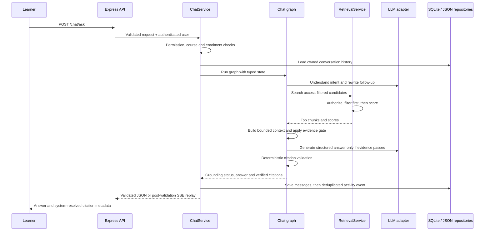
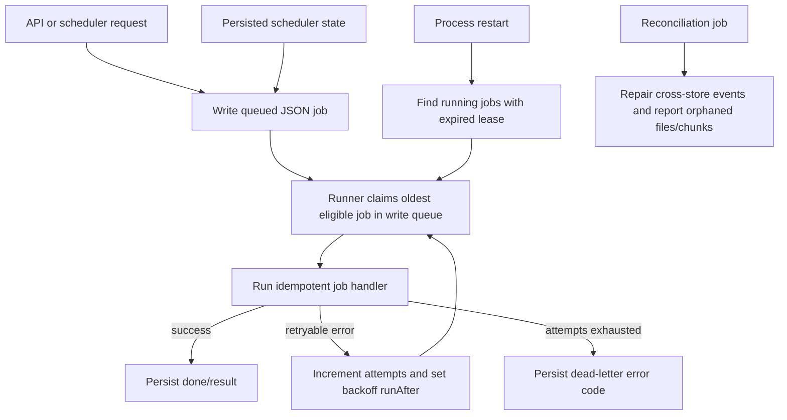

# Data Flow

**Status:** Approved implementation baseline for B2; open decisions remain gated.

## 1. Document ingestion

```mermaid
flowchart LR
  UP[Authenticated upload] --> AUTH[Permission and ownership checks]
  AUTH --> VAL[Extension, MIME, content and size validation]
  VAL --> HASH[Hash and duplicate check]
  HASH --> FILE[Store under random key outside web root]
  FILE --> META[Create uploaded document record]
  META --> JOB[Enqueue ingest job; return 202]
  JOB --> EXT[Extract PDF pages / DOCX sections / TXT]
  EXT --> CHK[Chunk with overlap and source metadata]
  CHK --> EMB[Mistral embedding adapter]
  EMB --> WRITE[Atomically write per-document chunk file]
  WRITE --> READY[Set document ready]
  EXT -->|low text or parse error| FAILED[Set actionable failure diagnostics]
```

Invalid uploads are rejected before enqueueing. Ingestion jobs are idempotent and report status through the document status endpoint.

## 2. Grounded chat

If evidence fails, no answer-generation call is made. If citation validation fails, the draft answer is suppressed. A validated answer is returned only after graph completion.

## 3. Job execution and recovery

Jobs store identifiers and parameters, not document or question text. Shutdown stops new claims and gives in-flight jobs the configured grace period to finish.
