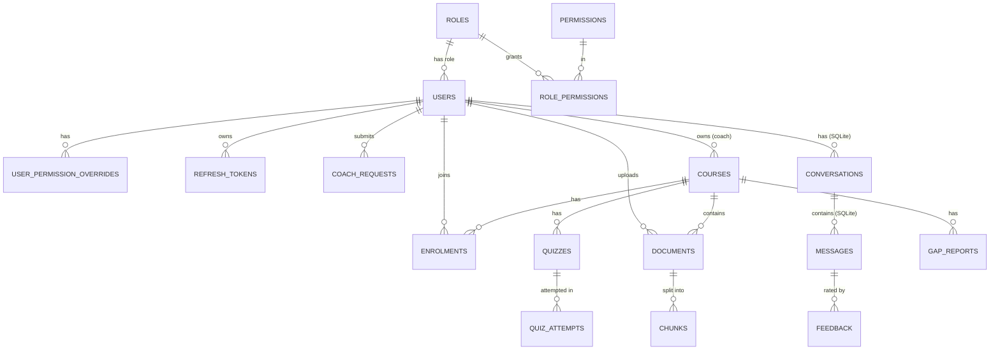

# AI Learning Assistant: Data Design (B1)

**Status:** Original B2 data-model baseline; current runtime mapping is described below.

`docs/architecture/Database-Design.md`. Detailed field-level specification of every collection and table. Where this file and `backend-architecture.md` section 5 differ on field-level detail, **this file wins**; `design-decisions.md` still wins over both on product rules.

### Current runtime mapping (2026-11)

Neon PostgreSQL is the runtime store for users, roles, permissions, courses,
enrolments, documents, jobs, learning records, feedback, audit data and other
structured collections. Existing normalized Neon tables are reused; the
remaining structured collections use the existing schema's JSONB payload
tables. MongoDB stores conversations and messages, while daily chat quotas
remain in Neon. Source uploads and generated retrieval chunk files remain in
private `DATA_DIR` storage.

The detailed field definitions below remain the logical record contracts.
References to JSON collections and SQLite describe the legacy import format;
`npm run db:migrate` applies the additive Neon schema migration and
`npm run db:import-legacy` copies available JSON/SQLite data without deleting
the original files.

---

## 1. Conventions

| Topic | Rule |
|---|---|
| Types | JSON types: `string`, `number`, `integer`, `boolean`, `array`, `object`, `null`. Hints: `uuid` (UUIDv4 string), `iso8601` (UTC string, e.g. `2026-11-16T07:12:00.000Z`), `enum(...)`, `sha256` (hex), `f32b64` (base64 of little-endian Float32Array). Later mapping: `uuid` to string or ObjectId, `iso8601` to Date, `f32b64` to a vector field |
| Required | **R** = required, **O** = optional (may be absent or `null`) |
| IDs | Every record has `id: uuid`. IDs of other records are stored as plain strings (no foreign-key enforcement by the store; repositories enforce) |
| Timestamps | `createdAt` on every record; `updatedAt` on mutable records. Always UTC ISO-8601 |
| Validation | Every record is validated with Zod on load and on write. An invalid record on load fails startup with a clear error |
| Uniqueness | Declared per collection; enforced by the repository inside the store's write queue |
| Indexes | In-memory `Map` indexes built at load (**U** = unique, **N** = non-unique). Not files on disk. SQLite indexes are real SQL indexes |
| Soft delete | "Stash" = a `status` value, filtered by one shared helper. Hard delete = record removed |
| Tenancy | **Single-tenant.** "Ownership scope" below says who may read a record |
| Text/PII | Collections marked **no text** must never hold question text, answer text or document text |
| Versioning | `version: integer` where concurrent edits are possible (optimistic check). Store schema version in `data/json/_meta.json` |

### Files on disk
```
data/
  json/
    _meta.json                      { schemaVersion, createdAt, lastMigrationAt }
    users.json  roles.json  permissions.json  role_permissions.json  user_permission_overrides.json
    refresh_tokens.json  coach_requests.json  courses.json  enrolments.json
    documents.json  learning_summaries.json  flashcards.json  quizzes.json  quiz_attempts.json
    feedback.json  audit_logs.json  activity_events.json  jobs.json  agent_executions.json
    gap_reports.json  config_versions.json  scheduler_state.json  idempotency_keys.json
    chunks/<documentId>.json        one file per document (embeddings)
  sqlite/conversations.db           conversations, messages
  uploads/<storageKey>              original uploaded files (outside any web root)
  backups/<timestamp>/              snapshots
```

---

## 2. Logical relationships


Cross-store references (SQLite `messages` <-> JSON `feedback`, `activity_events`) are by plain ID and kept consistent by the application (architecture 5.5).

---

## 3. Identity and access collections

### 3.1 `users`
| Field | Type | Req | Notes |
|---|---|---|---|
| id | uuid | R | |
| email | string | R | Lower-cased, trimmed. **Unique** |
| passwordHash | string | R | argon2 hash. Never returned by any API |
| displayName | string | R | 1-80 chars |
| roleId | uuid | R | -> `roles.id` |
| permsVersion | integer | O | Access-token invalidation version; absent legacy values are treated as 1. Increment on role or permission changes |
| status | enum(`active`,`suspended`,`archived`) | R | Stash states. Only `active` can authenticate |
| mustChangePassword | boolean | R | `true` after bootstrap/admin reset |
| failedLoginCount | integer | R | Resets on success |
| lockedUntil | iso8601 \| null | O | Lockout window |
| resetTokenHash | string \| null | O | Admin-initiated reset (one-time) |
| resetTokenExpiresAt | iso8601 \| null | O | |
| passwordChangedAt | iso8601 \| null | O | |
| lastLoginAt | iso8601 \| null | O | |
| erasedAt | iso8601 \| null | O | Set by privacy erasure; identity fields are tombstoned |
| pseudonymId | uuid \| null | O | One-way pseudonym used in analytics after erasure |
| createdAt, updatedAt | iso8601 | R | |

**Indexes:** `id` U; `email` U; `roleId` N; `status` N. **Scope:** a user reads their own; admin reads all (no content fields exist here). **Retention:** never deleted; stash or erase (architecture 14).

```json
{ "id": "u-1a2b", "email": "thandi@example.test", "passwordHash": "$argon2id$...", "displayName": "Thandi",
  "roleId": "role-learner", "status": "active", "mustChangePassword": false, "failedLoginCount": 0,
  "lockedUntil": null, "createdAt": "2026-11-16T07:12:00.000Z", "updatedAt": "2026-11-16T07:12:00.000Z" }
```

### 3.2 `roles`, `permissions`, `role_permissions`
| Collection | Fields | Indexes |
|---|---|---|
| `roles` | id, name enum(`learner`,`coach`,`admin`) R, description O, createdAt | `name` U |
| `permissions` | id, key string R (e.g. `course:create`), area string R, description O | `key` U |
| `role_permissions` | roleId R, permissionId R | (`roleId`,`permissionId`) U; `roleId` N |

Seeded by bootstrap; rows are added, never removed, by bootstrap. **Scope:** read by the auth layer; changed only by migrations/bootstrap (runtime role-permission editing is not in scope).

### 3.3 `user_permission_overrides`
| Field | Type | Req | Notes |
|---|---|---|---|
| id | uuid | R | |
| userId | uuid | R | -> `users.id` |
| permissionId | uuid | R | -> `permissions.id` |
| effect | enum(`grant`,`revoke`) | R | |
| changedBy | uuid | R | admin |
| createdAt | iso8601 | R | |

**Indexes:** (`userId`,`permissionId`) U; `userId` N. **Effective permissions** = role baseline + grants - revokes. Each change writes an `audit_logs` row.

### 3.4 `refresh_tokens`
| Field | Type | Req | Notes |
|---|---|---|---|
| id | uuid | R | |
| userId | uuid | R | |
| familyId | uuid | R | One family per login; rotation keeps the family |
| tokenHash | sha256 | R | Hash only; raw token never stored |
| createdAt | iso8601 | R | |
| expiresAt | iso8601 | R | |
| usedAt | iso8601 \| null | O | Set on rotation |
| revokedAt | iso8601 \| null | O | |
| replacedByTokenId | uuid \| null | O | |

**Indexes:** `tokenHash` U; `familyId` N; `userId` N; `expiresAt` N (prune). **Rule:** presenting a token with `usedAt` or `revokedAt` set revokes the whole family. **Retention:** pruned after `expiresAt` + grace.

### 3.5 `coach_requests`
| Field | Type | Req | Notes |
|---|---|---|---|
| id | uuid | R | |
| userId | uuid | R | |
| status | enum(`pending`,`approved`,`rejected`) | R | |
| message | string | O | Applicant note, max 500 chars |
| requestedAt | iso8601 | R | |
| decidedBy | uuid \| null | O | admin |
| decidedAt | iso8601 \| null | O | |
| decisionNote | string \| null | O | |

**Indexes:** `userId` N; `status` N. **Rule:** at most one `pending` request per user. Decisions are idempotent; a conflicting decision returns `CONFLICT`.

---

## 4. Course and enrolment collections

### 4.1 `courses`
| Field | Type | Req | Notes |
|---|---|---|---|
| id | uuid | R | |
| ownerId | uuid | R | Coach |
| name | string | R | 1-120 chars |
| description | string | O | Max 2000 chars. Shown on the join card |
| status | enum(`active`,`archived`) | R | |
| archivedAt, archivedBy | iso8601 / uuid \| null | O | |
| version | integer | R | Optimistic concurrency |
| createdAt, updatedAt | iso8601 | R | |

**Indexes:** `id` U; (`ownerId`,`status`) N; `status` N. **Scope:** active course cards expose only name/description to authenticated users; everything else is visible to the owner and approved members. If a coach is deactivated, an admin may reassign courses to an active coach or archive them. **Retention:** stash only.

### 4.2 `enrolments`
| Field | Type | Req | Notes |
|---|---|---|---|
| id | uuid | R | |
| courseId | uuid | R | |
| userId | uuid | R | Learner |
| status | enum(`pending`,`approved`,`rejected`,`removed`) | R | |
| requestedAt | iso8601 | R | |
| decidedBy | uuid \| null | O | Course owner |
| decidedAt | iso8601 \| null | O | |
| decisionNote | string \| null | O | |
| createdAt, updatedAt | iso8601 | R | |

**Indexes:** (`courseId`,`userId`) U; (`courseId`,`status`) N; (`userId`,`status`) N.
**Transitions:** `pending -> approved | rejected`; `approved -> removed`; `rejected -> pending` and `removed -> pending` (re-request, reusing the same record, after a configurable cool-down; default 24 hours, zero disables it). Re-applying the same decision is a no-op.
**Scope:** the learner sees their own; the course owner sees their course's; admin sees none of the content but may list enrolment metadata.

```json
{ "id": "en-77", "courseId": "c-12", "userId": "u-1a2b", "status": "approved",
  "requestedAt": "2026-11-16T08:00:00.000Z", "decidedBy": "u-coach1", "decidedAt": "2026-11-16T08:30:00.000Z",
  "decisionNote": null, "createdAt": "2026-11-16T08:00:00.000Z", "updatedAt": "2026-11-16T08:30:00.000Z" }
```

---

## 5. Document and retrieval collections

### 5.1 `documents`
| Field | Type | Req | Notes |
|---|---|---|---|
| id | uuid | R | |
| courseId | uuid | R | |
| ownerId | uuid | R | Uploader: the coach (scope `course`) or the learner (scope `personal`) |
| scope | enum(`course`,`personal`) | R | Immutable |
| filename | string | R | Sanitised display name |
| storageKey | string | R | Random key in `data/uploads/`; never derived from the filename |
| mimeType | string | R | Detected from content, must match extension allowlist |
| sizeBytes | integer | R | |
| contentHash | sha256 | R | Duplicate detection |
| status | enum(`uploaded`,`processing`,`ready`,`failed`,`deleting`) | R | See state machine below |
| errorCode | string \| null | O | e.g. `EXTRACTION_LOW_TEXT` |
| errorDetail | string \| null | O | Actionable, no document text |
| extractionDiagnostics | object \| null | O | `{ parser, pageCount, charCount, lowTextPages[], warnings[] }` |
| chunkCount | integer \| null | O | |
| embeddingModel | string \| null | O | Model used for the current chunks |
| ingestJobId | uuid \| null | O | |
| createdAt, updatedAt | iso8601 | R | |
| readyAt | iso8601 \| null | O | |

**State machine:** `uploaded -> processing -> ready | failed`; `failed -> processing` (retry); `ready | failed -> deleting -> (removed)`; `ready -> processing` (re-embed).
**Indexes:** `id` U; `courseId` N; (`courseId`,`scope`,`ownerId`) N; (`courseId`,`scope`,`ownerId`,`contentHash`) U (excluding `deleting`); `status` N.
**Scope:** `course` documents: course owner and approved members (metadata and citations only; learners see the library). `personal` documents: **owner only**; never coach, never admin. **Retention:** hard delete (architecture 14).

```json
{ "id": "d-7", "courseId": "c-12", "ownerId": "u-coach1", "scope": "course", "filename": "Databases.pdf",
  "storageKey": "9f3c1e...", "mimeType": "application/pdf", "sizeBytes": 2481923, "contentHash": "ab12...",
  "status": "ready", "errorCode": null, "errorDetail": null,
  "extractionDiagnostics": { "parser": "pdfjs-dist", "pageCount": 42, "charCount": 98122, "lowTextPages": [], "warnings": [] },
  "chunkCount": 118, "embeddingModel": "mistral-embed", "ingestJobId": "j-3",
  "createdAt": "2026-11-16T09:00:00.000Z", "updatedAt": "2026-11-16T09:01:10.000Z", "readyAt": "2026-11-16T09:01:10.000Z" }
```

### 5.2 `chunks/<documentId>.json` (collection `document_chunks`)
One file per document. The **header** holds the immutable access fields once, so they are not repeated per chunk. The loader flattens header + chunk into one in-memory record carrying all fields.

Header:
| Field | Type | Req | Notes |
|---|---|---|---|
| documentId | uuid | R | |
| courseId | uuid | R | Copied from the document at creation; immutable |
| ownerId | uuid | R | Copied; immutable |
| scope | enum(`course`,`personal`) | R | Copied; immutable |
| embeddingModel | string | R | e.g. `mistral-embed` |
| dimension | integer | R | e.g. 1024 (configured dimension; every vector is validated against it) |
| chunkCount | integer | R | |
| createdAt | iso8601 | R | |

Chunk (array `chunks[]`):
| Field | Type | Req | Notes |
|---|---|---|---|
| id | string | R | Deterministic: `<documentId>:<chunkIndex>`. Stable across retry so existing citations stay valid; may point to different text after re-chunking with new parameters |
| chunkIndex | integer | R | 0-based order in the document |
| text | string | R | Chunk text. **Contains course content: never logged, never sent to admin endpoints** |
| tokenEstimate | integer | R | chars/4 approximation |
| pageStart, pageEnd | integer | R | 1-based. TXT/DOCX without pages use `1` |
| section | string \| null | O | Detected heading, if any |
| embedding | f32b64 | R | Base64 Float32Array, length = `dimension` |

**In-memory indexes:** `id` U; `documentId` N; (`courseId`,`scope`,`ownerId`) N. A loaded-file LRU (config) caps memory.
**Retrieval filter** (applied before scoring): `courseId = X AND embeddingModel = current AND (scope='course' OR (scope='personal' AND ownerId = currentUser))`.
**Scope:** read only through the retrieval service. **Retention:** deleted with the document.

```json
{ "header": { "documentId": "d-7", "courseId": "c-12", "ownerId": "u-coach1", "scope": "course",
              "embeddingModel": "mistral-embed", "dimension": 1024, "chunkCount": 118, "createdAt": "2026-11-16T09:01:09.000Z" },
  "chunks": [ { "id": "d-7:41", "chunkIndex": 41, "text": "A transaction is a unit of work ...", "tokenEstimate": 412,
                "pageStart": 12, "pageEnd": 12, "section": "Transactions", "embedding": "<base64...>" } ] }
```

---

## 6. Learning content collections

All generated content links back to its sources through `sourceChunkIds`, which must be a subset of the context set sent to the model (rule V1/V2).

### 6.1 Generation request (shared shape, stored as `generationParams`)
`{ selection: { documentIds: uuid[] (required, 1-10), sections: string[] (O), topic: string (O, max 200) }, count: integer (quiz questions / flashcards), types: enum[] (O), difficulty: enum(easy,medium,hard) (O) }`.
**"Specialized" (DECIDED):** the learner picks the content they are studying (documents, optionally sections, optionally a topic phrase). The generator retrieves only from that selection, from course documents and the learner's own notes, subject to the usual access filter. Selected document IDs the user cannot access are rejected, not ignored.

### 6.2 `quizzes`
Each **version** is its own record. A quiz lineage shares `lineageId`.
| Field | Type | Req | Notes |
|---|---|---|---|
| id | uuid | R | |
| lineageId | uuid | R | Stable across versions |
| version | integer | R | Starts at 1 |
| courseId | uuid | R | |
| createdBy | uuid | R | |
| origin | enum(`coach`,`learner_generated`) | R | |
| visibility | enum(`course`,`private`) | R | `course` only when `origin=coach` |
| ownerId | uuid \| null | O | Required when `visibility=private` |
| status | enum(`draft`,`published`,`superseded`) | R | Learner quizzes are created `published` (private) |
| title | string | R | |
| questions | array of **Question** | R | Min 1 |
| sourceDocumentIds | uuid[] | R | |
| sourceChunkIds | string[] | R | Union of question sources |
| generationParams | object \| null | O | 6.1; null if hand-written |
| generatedBy | object \| null | O | `{ executionId, provider, model, promptVersion }` |
| publishedAt | iso8601 \| null | O | |
| createdAt, updatedAt | iso8601 | R | |

**Question** (embedded):
| Field | Type | Req | Notes |
|---|---|---|---|
| id | string | R | Stable within the lineage |
| type | enum(`mcq`,`true_false`) | R | |
| prompt | string | R | |
| options | array `{id, text}` | R | `mcq`: 2-5 options. `true_false`: ids `true`,`false` |
| correctOptionId | string | R | **Never sent to learners before submission** |
| explanation | string | R | **Never sent to learners before submission** |
| sourceChunkIds | string[] | R | Min 1 |

**Indexes:** `id` U; (`lineageId`,`version`) U; (`courseId`,`visibility`,`status`) N; `ownerId` N.
**Scope (after the enrolment check):** `visibility=course AND status=published` for approved members, plus the owner's own private quizzes. Coach (owner) sees drafts and all versions of their course's quizzes. **Learner responses use the learner view (no key).** **Retention:** coach quizzes stashed via `superseded`/archive with the course; private quizzes deleted by their owner (hard delete) or by erasure.

```json
{ "id": "q-9", "lineageId": "ql-4", "version": 1, "courseId": "c-12", "createdBy": "u-coach1", "origin": "coach",
  "visibility": "course", "ownerId": null, "status": "published", "title": "Week 3: Transactions",
  "questions": [ { "id": "qq1", "type": "mcq", "prompt": "Which property guarantees all-or-nothing execution?",
    "options": [ {"id":"a","text":"Atomicity"}, {"id":"b","text":"Isolation"}, {"id":"c","text":"Durability"} ],
    "correctOptionId": "a", "explanation": "Atomicity ensures a transaction fully completes or has no effect.",
    "sourceChunkIds": ["d-7:41"] } ],
  "sourceDocumentIds": ["d-7"], "sourceChunkIds": ["d-7:41"],
  "generationParams": { "selection": { "documentIds": ["d-7"], "topic": "transactions" }, "count": 1 },
  "generatedBy": { "executionId": "e-31", "provider": "inception", "model": "mercury-3", "promptVersion": "quiz.v1" },
  "publishedAt": "2026-11-16T10:00:00.000Z", "createdAt": "2026-11-16T09:40:00.000Z", "updatedAt": "2026-11-16T10:00:00.000Z" }
```

### 6.3 `quiz_attempts`
| Field | Type | Req | Notes |
|---|---|---|---|
| id | uuid | R | |
| quizId | uuid | R | The exact version attempted |
| lineageId | uuid | R | |
| quizVersion | integer | R | |
| courseId | uuid | R | |
| userId | uuid | R | Pseudonymised after erasure |
| answers | array `{questionId, selectedOptionId, correct: boolean}` | R | Scored server-side |
| score | integer | R | |
| maxScore | integer | R | |
| startedAt, submittedAt | iso8601 | R | |

**Indexes:** `id` U; (`userId`,`quizId`) N; (`courseId`,`lineageId`) N. **Scope:** the learner reads their own; the coach reads **aggregates only** (average score, per-question correct rate, completion) subject to `minCohortSize`; private-quiz attempts are excluded from coach analytics. **Retention:** kept while the user exists; deleted at erasure.

### 6.4 `learning_summaries`
| Field | Type | Req | Notes |
|---|---|---|---|
| id | uuid | R | |
| courseId | uuid | R | |
| createdBy, ownerId | uuid | R / O | `ownerId` set when private |
| visibility | enum(`course`,`private`) | R | |
| status | enum(`draft`,`published`) | R | Private summaries are `published` |
| scope | enum(`document`,`section`) | R | |
| sourceDocumentIds | uuid[] | R | |
| sectionRef | string \| null | O | |
| sourceChunkIds | string[] | R | |
| sourceHash | sha256 | R | Hash of source chunk ids + params; same request returns the stored result unless `regenerate=true` |
| version | integer | R | |
| title | string | R | |
| blocks | array `{heading, text, sourceChunkIds[]}` | R | |
| generatedBy | object \| null | O | as 6.2 |
| createdAt | iso8601 | R | |

**Indexes:** `id` U; `sourceHash` N; (`courseId`,`visibility`,`status`) N; `ownerId` N. **Scope/retention:** same rules as quizzes.

### 6.5 `flashcards` (one record per generated set, cards embedded)
| Field | Type | Req | Notes |
|---|---|---|---|
| id | uuid | R | |
| courseId | uuid | R | |
| createdBy, ownerId | uuid | R / O | |
| visibility, status | as 6.4 | R | |
| title | string | R | |
| sourceDocumentIds | uuid[] | R | |
| sourceHash | sha256 | R | |
| version | integer | R | |
| cards | array `{id, front, back, sourceChunkIds[]}` | R | Min 1 |
| generatedBy | object \| null | O | |
| createdAt | iso8601 | R | |

**Indexes:** as 6.4. **Scope/retention:** as quizzes.

---

## 7. Feedback and analytics collections

### 7.1 `feedback`
| Field | Type | Req | Notes |
|---|---|---|---|
| id | uuid | R | |
| messageId | string | R | -> SQLite `messages.id` |
| conversationId | string | R | |
| courseId | uuid | R | |
| userId | uuid | R | Pseudonymised after erasure |
| rating | enum(`helpful`,`not_helpful`) | R | |
| comment | string \| null | O | Max 1000 chars. Free text from the learner |
| groundingStatus | enum(`grounded`,`insufficient`,`unverified`) | R | Copied from the message |
| createdAt, updatedAt | iso8601 | R | |

**Indexes:** (`messageId`,`userId`) U (one rating per user per message; updates allowed); (`courseId`,`createdAt`) N. **Scope:** the author sees their own; coaches see **aggregates only** and, because comments are free text, see **no comment text** unless OPEN-19 is resolved otherwise. Comments feed the insights job as signals only. **Retention:** kept; pseudonymised at erasure.

### 7.2 `activity_events` (**no text**)
| Field | Type | Req | Notes |
|---|---|---|---|
| id | uuid | R | |
| dedupeKey | string | R | `messageId` or `attemptId` or job id. **Unique** (at-least-once writes, deduplicated) |
| courseId | uuid | R | |
| userId | uuid | R | Pseudonymised after erasure |
| type | enum(`question`,`summary`,`flashcards`,`quiz_generated`,`quiz_attempt`,`document_upload`) | R | |
| groundingStatus | enum(...) \| null | O | For `question` |
| usedPersonalScope | boolean | R | `true` if personal notes were in the context |
| citedCourseDocumentIds | uuid[] | R | Course-scope documents only (never personal notes); drives "content performance" |
| createdAt | iso8601 | R | |

**Indexes:** `dedupeKey` U; (`courseId`,`createdAt`) N; (`userId`,`createdAt`) N. **Scope:** coach aggregates (min cohort); admin aggregates (counts only). Events with `usedPersonalScope=true` are excluded from content-performance and gap analytics. **Retention:** kept (size-warned); user pseudonymised at erasure.

```json
{ "id": "ev-5", "dedupeKey": "m-81", "courseId": "c-12", "userId": "u-1a2b", "type": "question",
  "groundingStatus": "insufficient", "usedPersonalScope": false, "citedCourseDocumentIds": [],
  "createdAt": "2026-11-16T11:03:00.000Z" }
```

### 7.3 `gap_reports` (**no question text**)
| Field | Type | Req | Notes |
|---|---|---|---|
| id | uuid | R | |
| courseId | uuid | R | |
| periodStart, periodEnd | iso8601 | R | |
| totalGapQuestions | integer | R | |
| minCohortSizeUsed | integer | R | Value in force when generated |
| topics | array of **Topic** | R | Only topics meeting the cohort threshold |
| otherCount | integer | R | Gap questions merged into "Other" |
| generatedBy | object \| null | O | `{ executionId, provider, model, promptVersion }` |
| createdAt | iso8601 | R | |

**Topic:** `{ topicId: string, theme: string, questionCount: integer, distinctLearnerCount: integer, suggestedAction: string, trend: enum(up,down,flat,new), previousCount: integer | null }`. `theme` and `suggestedAction` are LLM-written labels and must not quote any learner question.
**Indexes:** `id` U; (`courseId`,`createdAt`) N. **Scope:** the course owner (`insights:view`). **Retention:** keep the latest N per course (config).

```json
{ "id": "g-2", "courseId": "c-12", "periodStart": "2026-11-09T00:00:00.000Z", "periodEnd": "2026-11-16T00:00:00.000Z",
  "totalGapQuestions": 31, "minCohortSizeUsed": 3, "otherCount": 4,
  "topics": [ { "topicId": "t1", "theme": "Assessment format", "questionCount": 14, "distinctLearnerCount": 9,
                "suggestedAction": "No document covers assessment format; consider uploading the exam guide.",
                "trend": "up", "previousCount": 6 } ],
  "generatedBy": { "executionId": "e-90", "provider": "inception", "model": "mercury-3", "promptVersion": "gaplabel.v1" },
  "createdAt": "2026-11-16T12:00:00.000Z" }
```

---

## 8. System collections

### 8.1 `jobs`
| Field | Type | Req | Notes |
|---|---|---|---|
| id | uuid | R | |
| type | enum(`ingest`,`reembed`,`generate`,`cluster`,`cleanup`,`reconcile`,`backup`,`prune`) | R | |
| status | enum(`queued`,`running`,`done`,`failed`,`dead`) | R | |
| attempts | integer | R | |
| maxAttempts | integer | R | |
| runAfter | iso8601 | R | Backoff / scheduling |
| lockedUntil | iso8601 \| null | O | Lease for the running job |
| leaseToken | uuid \| null | R | Identifies the current lease; stale workers cannot complete a reclaimed job |
| payload | object | R | **IDs and parameters only; never document or question text** |
| result | object \| null | O | Small summary / resource ids |
| error | `{code, message}` \| null | O | |
| createdBy | string | R | userId or `system` |
| requestId | string \| null | O | |
| scheduleKey | string | O | Unique task/occurrence key for idempotent scheduler dispatch |
| createdAt, updatedAt | iso8601 | R | |
| finishedAt | iso8601 \| null | O | |

**Indexes:** `id` U; (`status`,`runAfter`) N; (`type`,`status`) N; `scheduleKey` U when present. New jobs default to three attempts (maximum ten), with exponential retry backoff. An expired running lease is reclaimed as another attempt. Retryable failures become `dead` at the attempt limit; non-retryable failures become `failed`. Admin retry resets either terminal state to `queued`. **Scope:** the creator sees safe status metadata; admins with `executions:view` see all job metadata. Payload and result are never included in status APIs. **Retention:** `done` jobs pruned after N days; `dead` jobs kept until acted on.

```json
{ "id": "j-3", "type": "ingest", "status": "done", "attempts": 1, "maxAttempts": 3, "runAfter": "2026-11-16T09:00:01.000Z",
  "lockedUntil": null, "leaseToken": null, "payload": { "documentId": "d-7" }, "result": { "chunkCount": 118 }, "error": null,
  "createdBy": "u-coach1", "requestId": "r-55", "createdAt": "2026-11-16T09:00:00.000Z",
  "updatedAt": "2026-11-16T09:01:10.000Z", "finishedAt": "2026-11-16T09:01:10.000Z" }
```

### 8.2 `agent_executions` (**metadata only**)
| Field | Type | Req | Notes |
|---|---|---|---|
| id | uuid | R | |
| executionId | string | R | Groups all node runs of one graph run |
| requestId | string | R | |
| graph | enum(`chat`,`learning`,`insights`) | R | |
| node | string | R | |
| status | enum(`ok`,`error`,`timeout`,`skipped`) | R | |
| startedAt | iso8601 | R | |
| durationMs | integer | R | |
| tokenUsage | `{input:int, output:int}` \| null | O | |
| provider, model | string \| null | O | The one actually used |
| fallbackUsed | boolean | R | |
| retryCount | integer | R | |
| promptVersion | string \| null | O | |
| errorCode | string \| null | O | |
| userId, courseId, conversationId | uuid | R | Resource identifiers only |
| usageDate | `YYYY-MM-DD` | R | UTC day used for quota accounting |
| createdAt | iso8601 | R | |

**Never stored:** prompts, model outputs, retrieved text, question text. **Indexes:** `executionId` N; `createdAt` N; (`graph`,`node`,`createdAt`) N. **Scope:** admin (`executions:view`). **Retention:** 30 days by default.

### 8.3 `audit_logs` (append-only)
| Field | Type | Req | Notes |
|---|---|---|---|
| id | uuid | R | |
| actorId | string | R | userId or `system` |
| actorRole | string | R | |
| action | string | R | e.g. `user.role_changed`, `coach_request.approved`, `document.deleted`, `config.updated`, `bootstrap.admin_created`, `user.erased` |
| targetType | string | R | |
| targetId | string | R | |
| before, after | object \| null | O | Only whitelisted non-content fields (role, status, permission keys, config keys). **Never secrets or content** |
| requestId | string \| null | O | |
| createdAt | iso8601 | R | |

**Indexes:** (`targetType`,`targetId`) N; (`actorId`,`createdAt`) N; `createdAt` N. **Scope:** admin (`audit:view`). **Retention:** kept (size-warned); never edited.

### 8.4 `config_versions`
`id`, `version` (integer, **U**), `changedBy`, `before` (object), `after` (object), `reason` (O), `createdAt`. Config values only; **never secrets**. Scope: admin. Retention: kept.

### 8.5 `scheduler_state`
`id` (uuid), `taskName` (string, **U**), `lastRunAt` (iso8601 | null), `nextRunAt` (iso8601), `lastStatus` (enum `ok`,`error`,`skipped`). Scheduler occurrences are enqueued with a unique `scheduleKey` before advancing `nextRunAt`; a restart between those writes reuses the same job rather than dispatching a duplicate.

### 8.6 `idempotency_keys`
`keyHash` (sha256 of userId + route + client key, **U**), `requestHash` (sha256 of the body), `status` (integer), `resourceRef` (object | null, e.g. `{type, id}`), `createdAt`, `expiresAt`. **Stores no response body** (it could contain course content). A repeated key with the same `requestHash` returns the same resource reference; a different body returns `CONFLICT`. Pruned after `expiresAt`.

---

## 9. SQLite: conversation history

File `data/sqlite/conversations.db`, WAL mode, foreign keys on, parameterised queries only.

### 9.1 `conversations`
| Column | Type | Null | Notes |
|---|---|---|---|
| id | TEXT PK | no | uuid |
| user_id | TEXT | no | Owner. Only this user may read it |
| course_id | TEXT | no | |
| title | TEXT | yes | Defaults from the first question (truncated); user can rename |
| created_at | TEXT | no | ISO-8601 |
| updated_at | TEXT | no | Bumped on each message |

**Delete behaviour (DERIVED):** deleting a conversation is a **hard delete** (it holds learner text); messages go with it (`ON DELETE CASCADE`). Feedback and activity events remain, carrying only IDs and no text.

### 9.2 `messages`
| Column | Type | Null | Notes |
|---|---|---|---|
| id | TEXT PK | no | uuid |
| conversation_id | TEXT | no | FK -> `conversations(id)` ON DELETE CASCADE |
| role | TEXT | no | CHECK in (`user`,`assistant`) |
| content | TEXT | no | Question or validated answer. For `insufficient`/`unverified` assistant turns, the user-facing message |
| created_at | TEXT | no | |
| execution_id | TEXT | yes | Assistant messages |
| intent | TEXT | yes | `question`/`explanation`/`summary`/`quiz`/`flashcards`/`other` |
| grounding_status | TEXT | yes | CHECK in (`grounded`,`insufficient`,`unverified`) |
| cited_chunk_ids | TEXT | yes | JSON array of chunk ids |
| cited_document_ids | TEXT | yes | JSON array |
| citations | TEXT | yes | JSON array of system-resolved citation display metadata |
| retrieval_score_top | REAL | yes | |
| question_embedding_ref | TEXT | yes | Reference to the question vector for clustering. **Open detail:** store inline as base64 in this column, or recompute on demand at clustering time (recommended: recompute, to avoid storing a second copy of learner text-derived data) |

**Indexes**
```
CREATE INDEX idx_conv_user_course_updated ON conversations(user_id, course_id, updated_at DESC);
CREATE INDEX idx_msg_conv_created ON messages(conversation_id, created_at);
CREATE INDEX idx_msg_grounding ON messages(grounding_status) WHERE grounding_status IS NOT NULL;
```
**Scope:** owner only. Coach and admin code paths must not open this database for content (they use `activity_events`, `gap_reports`, `feedback`). The insights job reads question text here **inside the job only** and persists themes only. **Retention:** until the user deletes the conversation or is erased.

### 9.3 `chat_daily_usage`
| Column | Type | Null | Notes |
|---|---|---|---|
| user_id | TEXT | no | |
| usage_date | TEXT | no | UTC `YYYY-MM-DD` |
| request_count | INTEGER | no | Daily request quota |
| token_count | INTEGER | no | Recorded provider token usage |

Primary key: (`user_id`, `usage_date`). This table contains quota counts only; node execution metadata is stored in the JSON `agent_executions` collection.

```json
{ "id": "m-81", "conversation_id": "cv-4", "role": "assistant", "content": "The course material doesn't cover this question.",
  "created_at": "2026-11-16T11:03:00.000Z", "execution_id": "e-77", "intent": "question",
  "grounding_status": "insufficient", "cited_chunk_ids": "[]", "cited_document_ids": "[]", "retrieval_score_top": 0.31 }
```

---

## 10. Cross-store references and integrity

| From | To | Rule on delete/stash |
|---|---|---|
| `documents.courseId` | `courses.id` | Course archived: documents retained, excluded from retrieval |
| `chunks.documentId` | `documents.id` | Hard-delete job removes the chunk file first, then the record |
| `enrolments.userId/courseId` | `users`, `courses` | Stash cascades logically (access denied), records kept |
| `quizzes.sourceChunkIds` | chunks | A deleted source leaves the quiz readable; the source shows "source removed" |
| `messages.cited_*` | chunks, documents | Same: "source removed" |
| `feedback.messageId` | SQLite `messages.id` | Orphans (deleted conversations) are harmless; reconciliation may prune them |
| `activity_events.dedupeKey` | message / attempt ids | Reconciliation repairs missing or orphaned events |

The reconciliation job also reports: chunk files without a document, documents whose course or owner no longer exists, uploaded files without a document, and documents stuck in `processing` or `deleting` beyond a timeout.

---

## 11. Retention and deletion summary

| Data | Rule |
|---|---|
| users, courses, enrolments | Stash; never hard-deleted except by privacy erasure of identity fields |
| Personal notes (document, chunks, file) | **Hard delete**, user warned it cannot be undone |
| Coach course documents (document, chunks, file) | **Hard delete**, coach warned |
| Private quizzes, summaries, flashcards | Hard delete by the owner or at erasure |
| Coach quizzes/summaries | Superseded or archived with the course |
| Conversations and messages | Hard delete by the user or at erasure |
| `refresh_tokens` | Pruned after expiry |
| `jobs` | `done` pruned after N days; `dead` kept |
| `agent_executions` | 30 days (config) |
| `audit_logs`, `activity_events` | Kept, size-warned; users pseudonymised at erasure |
| `gap_reports` | Latest N per course |
| `idempotency_keys` | Pruned after expiry |
| Backups | Last N snapshots (config); an erased user's data persists in older backups until they roll off, which the privacy notice should state |

---

## 12. Open points for this design

| ID | Question | Recommendation |
|---|---|---|
| OPEN-19 | May coaches see feedback comment text? (conflicts with "themes only") | No. Use comments as signals in the insights job only |
| OPEN-21 | Store the question embedding in `messages` or recompute at clustering time | Recompute |
| OPEN-22 | Hard delete vs stash for conversations | Hard delete (assumed above) |
