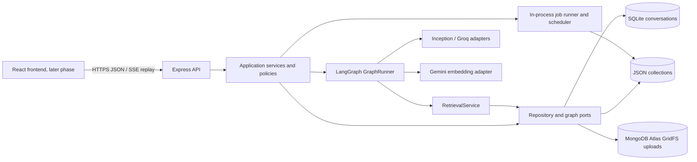

# High-Level Design

**Status:** Approved implementation baseline for B2; open decisions remain gated.

## System context

The product supports learners studying course material uploaded by coaches, plus private learner notes. Learners can ask grounded questions and generate learning content. Coaches manage their courses and see cohort-level themes. Admins manage the system without access to content or message text.

## Logical topology

## Major subsystems

1. **HTTP/API:** Express routes, request validation, authentication, permissions, error mapping, pagination, request IDs and OpenAPI.
2. **Identity and domain services:** users, roles, permissions, courses, enrolments, documents, learning content, feedback, insights, administration and audit.
3. **Storage infrastructure:** JSON collection engine with atomic single-writer persistence; SQLite for conversation history; private source uploads in MongoDB Atlas GridFS and generated chunk files on local persistent storage.
4. **Jobs:** durable JSON job records, bounded retries, idempotent handlers, scheduled backups/reconciliation/retention.
5. **AI workflows:** typed LangGraph nodes, provider adapters, access-filtered retrieval, context construction, evidence gating and deterministic citation validation.
6. **Operations:** validated configuration, structured redacted logs, health/readiness endpoints, backups, restore and a single-container deployment.

## Deployment view

Deploy one backend container with `data/` mounted to persistent storage. The container runs the API, job runner and scheduler in one process. Secrets are injected through environment variables or a secret manager, never committed. The React frontend is a separate later phase and communicates only through the public API.

AWS versus Azure is intentionally unresolved. The deployment design must not assume horizontal scaling while JSON stores remain in use.

## Reliability and scale assumptions

- Classroom-scale datasets: thousands of records and approximately 20,000 chunks at 1024 dimensions.
- Atomic temp-file-and-rename writes, per-collection write queues and startup validation protect the JSON store.
- Job retries and idempotent operations recover multi-step work after process restarts.
- SQLite uses WAL and one connection. Cross-store operations are reconciled rather than treated as distributed transactions.
- A future database migration replaces repository implementations and wiring; service contracts should not expose storage-specific assumptions.
